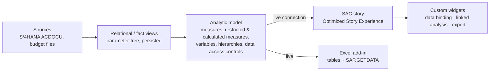

# SAP Analytics Cloud Custom Widgets: Complete Guide

All chapters of the SAC Custom Widget Kit documentation in one file (generated 01 Nov 2026). The kit itself (widgets, build, harness, tests) is described in the README of the kit folder; the per-widget property/method/event tables are in `docs/reference/`.

## Chapters

- [01 — SAP Analytics Cloud Custom Widgets: Master Guide](#01--sap-analytics-cloud-custom-widgets-master-guide)
- [02 — Linked Analysis Cookbook](#02--linked-analysis-cookbook)
- [03 — Tables, Excel Export and the Excel Add-in](#03--tables-excel-export-and-the-excel-add-in)
- [04 — Waterfall and Bridge Guide](#04--waterfall-and-bridge-guide)
- [05 — What You Can Build with Custom Widgets: Possibilities Catalog](#05--what-you-can-build-with-custom-widgets-possibilities-catalog)
- [06 — Deployment, Testing and Troubleshooting](#06--deployment-testing-and-troubleshooting)
- [07 — SAP Datasphere Analytic Models for the Widgets](#07--sap-datasphere-analytic-models-for-the-widgets)
- [08 — Resource Library](#08--resource-library)
- [09 — Beyond Native SAC: Visuals, Card Types and Features Worth a Custom Widget](#09--beyond-native-sac-visuals-card-types-and-features-worth-a-custom-widget)

---

# 01 — SAP Analytics Cloud Custom Widgets: Master Guide

How SAC custom widgets work from end to end, and how this kit uses each part. Everything here applies to
**Optimized Story Experience** stories and to analytic applications that run in optimized view mode, which is
where data binding, linked analysis, bookmarks and viewport loading are available.

> Status: checked in November 2026 against the SAP *Custom Widget Developer Guide*, document version **2026.8
> (24 June 2026)**, read in full, plus the *Widget Add-On Developer Guide*, SAP Help and the SAP Community posts
> listed in [08 — Resource Library](#08--resource-library). Chapter references such as "(guide ch. 13)" point to that
> document. Anything marked **Verify** depends on your tenant's release; check it once in a test story.

---

## Contents

1. [What a custom widget is, and when to use something else](#1-what-a-custom-widget-is-and-when-to-use-something-else)
2. [Anatomy: the files](#2-anatomy-the-files)
3. [The custom widget JSON](#3-the-custom-widget-json)
4. [The web component and its lifecycle](#4-the-web-component-and-its-lifecycle)
5. [Data binding](#5-data-binding)
6. [Script API: properties, methods, events](#6-script-api-properties-methods-events)
7. [Styling panel and builder panel](#7-styling-panel-and-builder-panel)
8. [Story features: linked analysis, bookmarks, viewport loading, export, mobile](#8-story-features)
9. [Hosting, integrity, versions, permissions, transport](#9-hosting-integrity-versions-permissions-transport)
10. [Restrictions](#10-restrictions)
11. [Widget add-ons](#11-widget-add-ons)
12. [Security](#12-security)
13. [Performance](#13-performance)
14. [Debugging](#14-debugging)
15. [How the kit is built](#15-how-the-kit-is-built)

---

## 1. What a custom widget is, and when to use something else

A custom widget is a **Web Component** (a custom HTML element with its own shadow DOM) plus a **JSON metadata
file**. SAC reads the JSON, loads the JavaScript, creates the element on the canvas and talks to it through a
small set of lifecycle functions. To the story designer it looks like any other widget: it sits in the
*Insert → Custom Widgets* menu, it can be moved and resized, it has a Builder panel (data binding), a Styling
panel (your properties), script methods and events.

SAC has four ways to go beyond the standard widgets. Pick the lightest one that does the job:

| Option | What it is | Use it when | Keep in mind |
|---|---|---|---|
| **Native widget + settings** | Built-in chart/table, conditional formatting, calculations | The standard chart can do it (the native waterfall, for example, has variance and subtotal options) | Fully supported: theming, comments, scheduling, translation, export |
| **Composite** | A reusable group of standard widgets + script, saved as its own file and transportable | You want a reusable *assembly* (header, navigation, KPI strip, a pre-configured chart) | No new visuals: it reuses standard widgets |
| **Widget add-on** | JavaScript that customises part of a *standard* chart: tooltip, plot area (general / numeric point) | The standard chart is right but you need a richer tooltip or extra marks on the plot | Data binding, filters and interactivity stay native. Plot-area add-ons don't support every chart type (see §11) |
| **Custom widget** | Your own Web Component, any library | You need a visual or interaction SAC doesn't have: bridges with zoom/Top N/inverted signs, IBCS charts, trees, Sankey, exportable formatted grids, selectors, integrations | You own rendering, formatting, accessibility, export and testing (see §10 for what is not supported) |

SAP also ships a **Custom Widget Library** (August 2026): eighteen chart types built on D3.js and ECharts by the SAC team
and HCLTech, installed with one click from *Explore custom charts*. Three caveats: it is currently available to **SAP
Business Data Cloud** customers only (the SAC tenant must be in the BDC formation; SAP Note 3798532 covers a missing
*Explore custom charts* option), the widgets are published as **samples**, and they don't inherit the story theme.
Announced next: dumbbell, dotted/dashed line, trend/forecast overlay, org chart and tornado.

---

## 2. Anatomy: the files

| File | Required | Purpose | In this kit |
|---|---|---|---|
| Custom widget JSON | Yes | Metadata: ID, version, web components, properties, methods, events, data bindings, capability flags | `dist/<widget>/<widget>.json` (+ `.prod.json`, `.external.json`) |
| Main web component JS | Yes | The widget itself (custom element, `kind: "main"`) | `dist/<widget>/<widget>.js` |
| Styling panel JS | No | Custom element shown in the Styling panel at design time (`kind: "styling"`) | `dist/<widget>/<widget>-styling.js` (generated) |
| Builder panel JS | No | Custom element shown in the Builder panel (`kind: "builder"`) | Not used (see §7) |
| Icon | No | Shown in the widget menu; 16×16 is the documented size | Inline PNG data URI generated by the build |
| Other resources | No | Extra JS, images | Vendor libraries are bundled *into* the main JS |

For SAC-hosted widgets you upload the JSON **and** a ZIP with the resource files; for externally hosted widgets you
upload only the JSON and the JSON points at your HTTPS server (§9).

---

## 3. The custom widget JSON

### 3.1 Root object

The guide is strict: *"Any other properties present in a custom widget JSON render it invalid."*

| Key | Required | Notes |
|---|---|---|
| `id` | Yes | Unique, reverse-domain style (`com.company.widget`). The identity of the widget on the tenant. |
| `version` | Yes | `major.minor.patch` (§9.4). |
| `name` | Yes | Shown in the widget menu. |
| `newInstancePrefix` | Yes | Script name prefix: the first instance becomes `<prefix>_1`. |
| `webcomponents` | Yes | One entry per component: `kind` (`main` \| `styling` \| `builder`), `tag`, `url`, `integrity`, optional `ignoreIntegrity` and `type` (`"module"` loads the file as an ES module). |
| `properties`, `methods`, `events` | Yes | Can be empty objects. |
| `description`, `vendor`, `license`, `eula` | No | Informational; `description` is used in tooltips. |
| `icon` | No | 16 × 16 px; a URL or a data URL. |
| `dataBindings` | No | Only **one** binding object is used (the first one); see §3.5. |
| `types` | No | Custom data structures and enumerations (§6.4). |
| `imports` | No | Type libraries for Script API types used in native functions, e.g. `["table", "input-controls"]`; `standard` loads automatically. |
| `supportsMobile` | No | Render in the mobile app; otherwise a placeholder is shown there. |
| `supportsExport` | No | Include the widget in PDF / PowerPoint / Google Slides export (§8.4). |
| `supportsBookmark` | No | Optimized Story Experience: bookmarks (§8.2). |
| `supportsLinkedAnalysisFilterOnSelection` | No | Optimized Story Experience: linked-analysis source with *Filter on Data Point Selection*. |
| `supportsViewportLoading` | No | Optimized Story Experience: load when scrolled into view. |
| `supportsLWV` | No | Optimized Story Experience: allow the **Lite Viewer** (§8.5). Default `false`. |

Tag rules: lowercase with at least one hyphen. The guide recommends the widget ID with dots replaced by hyphens, plus
the major version (`com-sap-sample-coloredbox-1`), so that two majors can live side by side. `tools/build.py`
validates all of this.

### 3.2 Properties

```json
"properties": {
  "chartTitle":  { "type": "string",  "default": "",   "description": "Title shown above the chart" },
  "decimals":    { "type": "integer", "default": 1,    "description": "Decimal places" },
  "exportToken": { "type": "integer", "default": 0,    "description": "Command counter", "includeInBookmarks": false }
}
```

- **Types:** `string`, `number`, `integer`, `boolean`, their arrays (`string[]`, …), **simple object types**
  `Object<type>` (string keys, values of a simple or custom type), custom types from `types`, and some Script API
  types.
- `default` is optional (properties without one start as `undefined`). `includeInBookmarks: false` keeps a property
  out of bookmarks (guide ch. 13).
- **Arrays in method bodies:** reassign after changing, e.g. `var l = this.items; l.push(x); this.items = l;`.
- **Never name a property after an `HTMLElement` member** (`title`, `hidden`, `id`, `style`, `lang`, `dir`, …). The kit
  uses `chartTitle`, `tableTitle`, `widgetTitle`.
- Story scripts can't read or write properties directly: expose methods (§6).
- **Property setters** (`set color(v) {…}`) are called by the framework if you implement them; getters are ignored.
  The kit doesn't use setters: it merges everything in `onCustomWidgetBeforeUpdate`.

### 3.3 Methods

Two implementation styles (guide ch. 6.1 and 14.3):

```json
"methods": {
  "setTopN":  { "description": "Top N steps (0 = all).",
                "parameters": [ { "name": "n", "type": "integer" } ],
                "body": "this.topN = n;" },                              // 1) script body
  "getDataSource": { "description": "Data source of the binding.", "returnType": "DataSource",
                "body": "return this.dataBindings.getDataBinding('dataBinding').getDataSource();" },
  "putNumber": { "description": "Native implementation.",
                "parameters": [ { "name": "name", "type": "string" }, { "name": "value", "type": "number" } ] }  // 2) no body
}
```

1. **With `body`:** SAC script that runs on a script view of the widget. `this.<property>` reads or writes a property,
   and the framework pushes the change to the web component through `onCustomWidgetBeforeUpdate/AfterUpdate`.
2. **Without `body`:** SAC calls the **native JavaScript function** of the same name on the main web component, so
   `putNumber(name, value) { … }` in the class. It can return values. If it changes a property, it must fire
   `propertiesChanged`, or later script reads return stale values.

Rules from the guide:

- **Don't mix styles for one property** (setter with a body and getter native, or the reverse). The framework batches
  property changes during a script, so mixed styles can return outdated values.
- **Arrays and simple objects:** returned **by reference** from `body` methods and **by value** (a copy) from native
  functions.
- **Script API objects passed as arguments** (e.g. a `Button`) may only be used inside the method call itself, not later
  in timers or event handlers. Their functions are asynchronous (`await button.getText()`).

The kit uses `body` methods with command tokens (§6.3) because they keep all state in properties, which also makes
script calls work in the local harness. A native function is the simpler choice for actions that return a result.

### 3.4 Events

```json
"events": { "onSelect": { "description": "A data point was selected." } }
```

The web component fires `this.dispatchEvent(new Event("onSelect"))`. The designer writes the handler in the script
editor (`WaterfallBridge_1` → *onSelect*). Events carry no payload; publish the payload as output properties first
and give scripts getters (§6.2).

### 3.5 Data bindings

```json
"dataBindings": {
  "dataBinding": {
    "feeds": [
      { "id": "dimensions", "description": "Category (bridge steps)", "type": "dimension" },
      { "id": "measures",   "description": "Measures",                "type": "mainStructureMember" }
    ]
  }
}
```

- **One binding per widget:** only the first object is used. One binding = one model. To combine models, feed a second
  data set by script (see [05 §7](#7-utility-widgets-no-or-little-ui)).
- Each feed becomes a slot in the **Builder panel that SAC generates automatically** when `dataBindings` exists.
  `dimension` feeds take dimensions (with hierarchies), `mainStructureMember` feeds take measures or accounts.
- If you declare your own `kind: "builder"` component, it **replaces** the generated panel, and with it the binding UI.
  That is why data-bound widgets (including all kit widgets) put their options in the Styling panel.

## 4. The web component and its lifecycle

```js
const tpl = document.createElement("template");
tpl.innerHTML = `<style>:host{display:block;width:100%;height:100%}</style><div class="root"></div>`;

class MyWidget extends HTMLElement {
  constructor() {                         // also runs for the drag preview at design time: keep it cheap
    super();
    this._shadow = this.attachShadow({ mode: "open" });
    this._shadow.appendChild(tpl.content.cloneNode(true));
    this._props = {};
  }
  onCustomWidgetBeforeUpdate(changed) { this._props = { ...this._props, ...changed }; }
  onCustomWidgetAfterUpdate(changed)  { this._render(); }
  onCustomWidgetResize(width, height) { this._render(); }   // omit it if the widget doesn't depend on size
  onCustomWidgetDestroy() { /* dispose charts, timers, observers */ }
  _render() { /* … */ }
}
if (!customElements.get("my-widget")) customElements.define("my-widget", MyWidget);
```

**Call order (guide ch. 6.2).** First render: `constructor` → `onCustomWidgetBeforeUpdate` → property setters →
`onCustomWidgetAfterUpdate` → `connectedCallback`. Update: `BeforeUpdate` → setters → `AfterUpdate`. Removal:
`onCustomWidgetDestroy` → `disconnectedCallback`. Resize: `onCustomWidgetResize(width, height)`, throttled by the
framework. Dragging a widget at design time clones it, so the constructor and connect/disconnect callbacks also run
for the clone.

**What `changedProperties` contains.** On the first call it contains all properties (the defaults, or `undefined`
without a default), plus built-in ones:

| Built-in | Meaning |
|---|---|
| `widgetName` | Instance name, e.g. `WaterfallBridge_1` (the kit uses it as a fallback export file name) |
| `designMode` | `true` while the story or application is being edited |
| `mobileMode` | `true` in the mobile app (passed when `supportsMobile` is true) |
| `<eventName>` | e.g. `onSelect: true` when a script is assigned to that event |
| `themeInfo` | Active theme, including its `themeId` |

**Rules:**

- **Don't fire `propertiesChanged` inside** the constructor, `BeforeUpdate`, `AfterUpdate`, `Destroy` or the
  connect/disconnect callbacks; it risks an endless loop (guide ch. 14.1). Fire it after user interaction or in native
  functions. The kit queues every `propertiesChanged` and event and dispatches them right after the current call
  stack, so outputs published while rendering (KPI status, selection cleared by script) are safe.
- A property you publish with `propertiesChanged` is **not** passed back to your own component, only to the
  Styling/Builder panels.
- `onCustomWidgetDestroy` is **not** called when the widget is only hidden (visibility false, inactive tab). Don't rely
  on it to stop timers on hidden widgets.
- Render from state, idempotently. Show a hint instead of throwing when there's no data.
- Guard `customElements.define` (two versions on one page would otherwise throw).
- Fire `customWidgetRenderComplete` after every render (§8.3, §8.4).

## 5. Data binding

### 5.1 What arrives

SAC sets a property named after the binding ID (`dataBinding` in this kit) with the result set:

```js
this._props.dataBinding = {
  data: [
    { dimensions_0: { id: "[Account_7h2kq01].[parentId].&[REV]", label: "Revenue", parentId: "[Account_7h2kq01].[parentId].&[GP]" },
      measures_0:   { raw: 1000000, formatted: "1.00 Million", unit: "USD" },
      measures_1:   { raw:  950000, formatted: "0.95 Million", unit: "USD" } },
    …
  ],
  metadata: {
    feeds: {
      dimensions: { values: ["dimensions_0"], type: "dimension" },
      measures:   { values: ["measures_0", "measures_1"], type: "mainStructureMember" }
    },
    dimensions:           { dimensions_0: { id: "Account_7h2kq01", description: "Account" } },
    mainStructureMembers: { measures_0: { id: "Actual", label: "Actual" }, measures_1: { id: "Budget", label: "Budget" } }
  }
};
```

- This is the shape documented in guide ch. 6.2.3: `data` and `metadata`. The guide's sample has **no `state`
  field**; SAP's samples (and the kit's harness) also see `state: "loading"` while a query runs. The kit treats a binding
  with a `data` array and no `state` as loaded, and anything else as loading/empty.
- One row per combination of dimension members; the keys `dimensions_N` / `measures_N` follow the order in the
  Builder panel.
- Measure IDs can be account unique names too (`[Account_X].[parentId].&[Discount]`) on account models.
- `raw` is the unformatted number; `formatted` is SAC's formatted text (scale and decimals from the model or story).
  Unit or currency information, when present, is picked up by the kit's parser but is not needed for rendering.
- **Member IDs can be unique names.** With a hierarchy you typically get `[Dim].[Hierarchy].&[MemberKey]`. Linked
  analysis expects exactly these IDs (§8.1). For display and for Excel the kit strips them to the key with
  `SacKit.plainMemberId()`.
- **Hierarchies:** rows carry `parentId` when a hierarchy is active on the dimension. Parent nodes come as rows of
  their own when **Include Parent Elements** is switched on in the hierarchy settings of the Builder panel (needed for
  trees, sunbursts and subtotals). The custom widget Builder panel doesn't offer *Show only leaves*, nor the hierarchy
  level choice for BW models. On BW Live, `parentId` can be present on one occurrence of a member and missing on its
  repeated rows (e.g. with a period dimension also bound); the kit's parser builds one parent map per dimension and fills
  the gaps. The kit handles both:
  trees in the table, automatic subtotals in the bridge, nested structures in treemap/sunburst/tree.
- The data binding returns only what is bound. To show "Actual vs Budget vs PY", bind three measures (on Datasphere
  build them as restricted measures, see [07](#07--sap-datasphere-analytic-models-for-the-widgets)).

The kit turns this into a stable structure with `SacKit.parseDataBinding(binding)`:

```js
{ state, dims: [{ key, id, label }], measures: [{ key, id, label, unit }],
  rows: [{ index, dims: [{ id, label, parentId }], values: [{ raw, formatted, unit }] }] }
```

### 5.2 The DataBinding and DataSource APIs

From the web component, `this.dataBindings.getDataBinding("dataBinding")` returns the binding's API (the binding name
can be omitted when there is only one). Calls are asynchronous: `await` them.

| DataBinding method | Use |
|---|---|
| `getDataSource()` | The DataSource Script API (filters, members, variables, result set) |
| `getLinkedAnalysis()` | `setFilters`, `removeFilters`, `isDataPointSelectionEnabled` (§8.1, [02](#02--linked-analysis-cookbook)) |
| `addDimensionToFeed(feed, dimensionId)` | Change the binding from code |
| `getMembers`, `addMemberToFeed`, `removeMember` | Member-level feed APIs. On models with both measures and accounts they apply to **accounts** only |
| `setModel`, `openSelectModelDialog` | Switch or pick the model (not available in the Lite Viewer) |

The full list is in the API reference under *DataBinding*.

**Not supported** for data-bound custom widgets (guide ch. 3): `getDataSource().getComments`, `.load`,
`.getDataExplorer`, `.getDataSelections`.

From story scripts, the kit exposes the data source through a method:

```js
var ds = WaterfallBridge_1.getDataSource();
ds.setDimensionFilter("Version", "public.Actual");
var members = ds.getMembers("Region");
```

**Builder panel gaps (guide ch. 3).** Compared with a chart or table, the custom widget Builder panel has no Color,
Chart Add-Ons or Chart Properties sections, can't rename dimensions or measures (and has no *Display As*), and can't add
dimension or measure input controls. Plan labels as widget properties.

## 6. Script API: properties, methods, events

### 6.1 Getter/setter pairs

Every property a script should change needs a method. Keep the pair consistent (the guide has a best-practice
section on this):

```json
"setOrientation": { "parameters": [ { "name": "orientation", "type": "string" } ], "body": "this.orientation = orientation;" },
"getBridgeMode":  { "returnType": "string", "body": "return this.bridgeMode;" }
```

### 6.2 Output properties (widget → script)

When the user clicks, the widget publishes the result as properties, then fires the event:

```js
this.dispatchEvent(new CustomEvent("propertiesChanged", {
  detail: { properties: { selectedMemberId: "REV", selectedMemberLabel: "Revenue", selectedValue: 1000000 } }
}));
this.dispatchEvent(new Event("onSelect"));
```

The designer then writes:

```js
// WaterfallBridge_1 – onSelect
var id = WaterfallBridge_1.getSelectedMemberId();
if (id !== "") {
  Table_1.getDataSource().setDimensionFilter("Account", id);
}
```

Output properties are saved with the story and in bookmarks; that's how the member selector restores its selection.
Note that publishing a property in edit mode can mark the story as changed.

### 6.3 Command properties (script → widget actions)

A `body` method can only set properties, so the kit triggers actions with a counter (the alternative is a native method without `body`, §3.3):

```json
"exportChart": {
  "parameters": [ { "name": "format", "type": "string" }, { "name": "fileName", "type": "string" } ],
  "body": "this.exportFormat = format; this.exportRequestFileName = fileName; this.exportToken = this.exportToken + 1;"
}
```

The web component sees `exportToken` change in `onCustomWidgetAfterUpdate` and runs the export once per new token
value (not on the first load). The same pattern drives `clearSelection`, `expandAll`/`collapseAll` and the table's
sort. Keep method bodies simple assignments. Command properties are excluded from bookmarks (§8.2).

### 6.4 Custom types

`types` lets a method accept or return structured objects (for example a selection record). The kit returns JSON
strings instead (`getSelectedRowJson()`), which every script can parse with `JSON.parse` and which survive
bookmarks and transport without extra type definitions.

---

## 7. Styling panel and builder panel

The **Styling panel** is a second web component (`kind: "styling"`), shown at edit time in the Styling tab under
*Custom Widget Additional Properties*. It gets the same lifecycle calls as the widget (except resize). It receives the
widget's properties through `onCustomWidgetBeforeUpdate/AfterUpdate` and sends edits with `propertiesChanged`. SAC
saves them with the story and forwards them to the widget. One panel instance is created per widget; clean up in
`onCustomWidgetDestroy`.

The kit generates the panel from the spec (`src/shared/panel-kit.js`): collapsible sections, text, number, checkbox,
select, colour (picker + hex) and multi-line fields, and *Reset all to defaults*. One spec entry = one JSON property +
one JS default + one panel field.

The **Builder panel** (`kind: "builder"`) fills the whole Builder tab. A data-bound widget gets an
**auto-generated** Builder panel with the feeds. A custom builder component replaces it (§3.5), so data-bound widgets
should use the Styling panel for their options.

## 8. Story features

### 8.1 Linked analysis

Only data-bound custom widgets take part in linked analysis (guide ch. 10). As a **target** (filtered by other widgets)
and as a **source without** *Filter on Data Point Selection* nothing needs to be coded. As a source **with** it, you need
`supportsLinkedAnalysisFilterOnSelection: true`, code that calls `getLinkedAnalysis().setFilters(selection)` and
`removeFilters()`, and the designer must select *Filter on Data Point Selection*. Recipes, selection formats and pitfalls
are in [02 — Linked Analysis Cookbook](#02--linked-analysis-cookbook).

### 8.2 Bookmarks

`supportsBookmark: true` lets story viewers save bookmarks that include the widget (not in analytics designer). When a
bookmark is opened, `onCustomWidgetAfterUpdate` runs with the bookmarked property values and data. All properties are
bookmarked by default; `includeInBookmarks: false` excludes one (built-ins such as width/height are always included).

The kit excludes its **command properties** (`exportToken`, `clearSelectionToken`, `expandToken`, `exportFormat`, …)
so that opening a bookmark can never replay an export or a clear. Selections, sort, search and chart type stay in.

Version changes (guide ch. 13): properties you delete or exclude later still arrive from old bookmarks, so read
defensively. A new **major** version is a different widget, so old bookmarks aren't affected.

### 8.3 Viewport loading

With `supportsViewportLoading: true` SAC loads the widget only when it scrolls into view (when the story's loading
optimisation is set to viewport loading). Firing `customWidgetRenderComplete` when drawing is finished is optional for
loading, but **export waits up to one minute for it**, so fire it after every render, including the empty and error
states. All kit widgets do (the ECharts widget on the chart's `finished` event). *Performance Insights* shows
"Load resource file of custom widget …" and "Render custom widget …" for each widget.

### 8.4 Export (PDF / PowerPoint / Google Slides)

With `supportsExport: true` the widget is included in story export. The guide warns that the default capture may miss
parts: **D3 axes aren't exported** and CSS styling may be lost. The documented fix is to implement
**`serializeCustomWidgetToImage(options)`** on the main component. It returns a Base64 PNG/JPG (as a promise or a
string) that SAC places in the export. Limits: 20 MB, 3-minute timeout, PNG/JPG/JPEG. On responsive pages the paper size
is always *Auto*.

```js
async serializeCustomWidgetToImage(options) {        // options: { pageSize, paperSize, orientation }
  return this._chart.getDataURL({ type: "png", pixelRatio: 2, backgroundColor: "#FFFFFF" });
}
```

The kit implements it in the **Waterfall / Bridge** (SVG rendered to PNG at 2×) and the **Universal Chart** (ECharts
image). The table, KPI card and selector use the default capture. Other export notes: filters on custom widgets
don't appear in the PDF appendix, and images loaded from other servers need CORS. For the *data* behind a widget, the
widgets export XLSX/CSV themselves (see [03](#03--tables-excel-export-and-the-excel-add-in)).

### 8.5 Mobile and Lite Viewer

**Mobile:** `supportsMobile: true` renders the widget in the mobile app (otherwise a placeholder appears). The
`mobileMode` property tells you at runtime. The guide asks for larger touch targets and alternatives to modifier-key
interactions (the kit's multi-select works with the `multiSelect` property, not only with Ctrl-click). Don't hide
essential numbers in hover tooltips.

**Lite Viewer:** a lightweight viewer of the Optimized Story Experience. A widget opts in with `supportsLWV: true`.
**Without it, the whole story falls back to the full viewer.** Things that break in the Lite Viewer: relying on a
preloaded SAPUI5 library, the DataBinding APIs `setModel` / `openSelectModelDialog`, and APIs listed in *Lite Viewer
Unsupported APIs*. The kit widgets don't use any of these, but they ship with `supportsLWV: false`, as the guide
recommends measuring first. To compare, open a test story with `app.html?force=lwv#/…` and `?force=app#/…`
(developer testing only). To enable it, set `"supportsLWV": true` in the widget's `supports` block in
`widget.spec.json` and rebuild.

## 9. Hosting, integrity, versions, permissions, transport

### 9.1 SAC-hosted (recommended)

Upload under *Stories* (or *Analytic Applications*) → **Custom Widgets** tab → **Create**: choose the JSON, then
**Select File** for the ZIP. Documented rules (guide ch. 4):

- URLs in the JSON start with a slash: `"url": "/waterfall-bridge.js"`.
- ZIP **≤ 10 MB**, extension `.zip`, **no subfolders**.
- The ZIP may contain only the main, styling and builder JavaScript files and the icon (**PNG or JPG**). **CSS and HTML
  files are not supported**, so bundle styles into the JS (the kit puts them in the shadow-DOM template).
- At most **50** custom widgets with SAP-hosted resources per tenant; needs **Create** permission on Custom Widget.
- Not supported on SAP **Neo** tenants.

(The 2023 announcement blog quoted 5 MB and 25 widgets; the 2026 guide says 10 MB and 50.)

### 9.2 External hosting

Upload only the JSON and serve the JS files over **HTTPS** from your own server (GitHub Pages, Azure Static Web
Apps, an SAP BTP HTML5 app, a CDN). The **user's browser** loads the files; SAC never connects to your server.
That means:

- The server must allow **CORS** for the SAC origin (`Access-Control-Allow-Origin`).
- Every user's browser must reach the server (VPN, proxy and firewall rules apply).
- Use `python3 tools/build.py --base-url https://host/path/<widget>` to get `<widget>.external.json` with absolute
  URLs and integrity hashes.

### 9.3 Integrity (SRI)

`integrity` is `sha256-<base64 of the SHA-256 of the file>`; with `ignoreIntegrity: false` the browser refuses a
file whose hash doesn't match. The kit writes `<widget>.json` (development, `ignoreIntegrity: true`) and
`<widget>.prod.json` (hashes, `ignoreIntegrity: false`). Use the `.prod.json` for production. Any change to the JS
means a new hash, so rebuild and upload JSON and ZIP together.

### 9.4 Versions

Documented for custom widgets (guide ch. 5.3): versions are `major.minor.patch`. **Different major versions can be
installed side by side** (1.0.0 and 2.0.0). **A different minor version replaces the installed one**: with 1.5.0
installed, uploading 1.4.0 *or* 1.6.0 replaces it. Practical rules for the kit:

- Bug fixes and new optional properties: raise minor/patch, keep `id` and `tag`. Every story picks it up.
- Breaking changes: raise the major **and** append it to the tag (`sackit-waterfall-bridge-2`, as the guide recommends).
  Existing stories and bookmarks keep the old major.
- Keep old property names readable for one major (map old → new in `onCustomWidgetBeforeUpdate`).
- **Deleting** a widget lists the stories and applications that use it and warns that they will break.

### 9.5 Permissions and transport

- Uploading needs the **Create** permission on the object type *Custom Widget* (*Widget Add-On* for add-ons);
  using one needs **Read**. Standard roles are often read-only; add the rights to a custom role for widget
  developers.
- Custom widgets can be transported between tenants with your other content (export/import). SAP documents that
  transporting SAC-hosted custom widgets from Cloud Foundry to Neo tenants is not supported.
- A story stores a reference to the widget (ID + version), not the code. Import the widget into the target tenant
  before (or with) the stories that use it.

---

## 10. Restrictions

From the guide's *Restrictions* chapter (version 2026.8):

**Browser:** Google Chrome and Microsoft Edge (version 79 and higher).

**Not supported for custom widgets** (analytics designer and Optimized Story Experience): theme and CSS, pause
refresh, data blending, commenting, scheduling, translation, Data Change Insights, Search to Insight.

**Analytics designer only, additionally:** linked analysis, bookmarks, and viewport/background loading (all three work
in the Optimized Story Experience).

**Export:** filters on custom widgets don't show in the PDF appendix; remote images need CORS.

**Data binding** (both environments): the Builder panel gaps listed in §5.2, and four unsupported DataSource APIs
(`getComments`, `load`, `getDataExplorer`, `getDataSelections`). **In analytics designer only:** universal account
models aren't supported for binding, binding needs optimized view mode, unbooked data can't be shown, filter lines don't
apply, and input controls affect the widget only at runtime.

**Hosting:** no SAP-hosted resources on Neo tenants, and no transport of SAC-hosted widgets from Cloud Foundry to Neo.

**CORS:** any `fetch`/XHR or web font from another origin needs the right CORS headers on that server.

What this means in practice: the widget does its own formatting (the kit has scale K/M/B, decimals, prefix/suffix,
± sign, parentheses for negatives and locale), colours must be properties because the story theme doesn't apply, and
translatable texts ("Others", "Total", "Δ %") must be properties too.

## 11. Widget add-ons

An add-on customises a **standard** chart instead of replacing it. Its JSON lists `extensions`, each with an
`extensionPoint`, its `webcomponents` (`main`, optional settings panel) and `properties`. One JSON can declare at most
one add-on of each type.

| Extension point | Supported charts |
|---|---|
| `sap.addOn.viz.tooltip` | All chart types except numeric point |
| `sap.addOn.viz.plotarea.general` | Bar/column, stacked bar/column, stacked area, line. **Not** the waterfall, **not** tables |
| `sap.addOn.viz.plotarea.numericPoint` | Numeric point |

**How a plot-area add-on works.** SAC calls `setExtensionData(data)` on the add-on with the rendered chart:

- chart type and size;
- `isHorizontal` and the clip path;
- one entry per series (name, colour), with each data point's position, size, colour and category;
- axis labels.

The add-on draws its own SVG/HTML from that data. Reserved boolean properties choose which original parts SAC hides:
`sapHideOriginalDataPointMarks`, `sapHideOriginalDataPointLabels`, `sapHideOriginalXAxisLabels`,
`sapHideOriginalYAxisLabels`, `sapHideOriginalXAxisStackLabels`, `sapHideOriginalYAxisStackLabels`.

Settings changes arrive through `onBeforeUpdate`/`onAfterUpdate`. A practical tip from the SAP sample: log the extension
data to the console once to see exactly what you get. A 2026 community comment reports that once a plot-area add-on
takes over, the original plot isn't drawn, so draw everything you need.

Data binding, filters and linked analysis stay native. Uploading needs **Create** on *Widget Add-On*; using it needs
**Read**; the version rules of §9.4 apply. Use add-ons for "native chart, better tooltip / extra marks". Use a custom
widget for chart types SAC doesn't have, which includes a configurable bridge (see
[04](#04--waterfall-and-bridge-guide)).

## 12. Security

- The widget runs **in the user's browser session**, in the SAC page. Treat it like any code you deploy into your
  production web app: code review, pinned versions, SRI hashes.
- **Escape everything that comes from data** before you put it into HTML (`SacKit.escapeHtml`). Member
  descriptions are user data.
- **No secrets in JavaScript.** API keys in a widget are readable by every user. Call external services through a
  backend that authenticates the user (for example an SAP BTP service with the SAC tenant as identity provider).
- Prefer **bundling** libraries into the widget over loading them from public CDNs at runtime (a CDN outage or
  compromise breaks every story). The kit bundles ECharts and wraps it so it creates no globals.
- Shadow DOM isolates CSS, not JavaScript. Don't modify `window`, global prototypes or SAC's DOM.

---

## 13. Performance

- **Data volume:** the widget receives the full result set of its binding. Bind only what you draw, use Top N in
  the Builder panel or in the widget, and avoid high-cardinality dimensions on rows. The kit's table has `maxRows`
  (default 3,000) as a safety net.
- **Render once per update.** Merge in `BeforeUpdate`, render in `AfterUpdate`. Skip renders triggered only by your
  own output properties.
- **Resize:** re-layout, don't re-parse. ECharts gets `chart.resize()`.
- **Viewport loading** for long stories (§8.3).
- **Bundle size:** the ECharts widget is ~1.1 MB of JS (~356 KB zipped), almost all of it the minified library. The
  SVG/HTML widgets are under 100 KB each.
- **Datasphere live:** every interaction is a query against Datasphere. Restricted measures and persisted views in
  the analytic model matter more than anything in the widget (see [07](#07--sap-datasphere-analytic-models-for-the-widgets)).

---

## 14. Debugging

1. **Local first:** `tools/harness/index.html` emulates SAC (properties, data binding, linked analysis log, script
   methods, events, Styling panel) with sample result sets. See [06](#06--deployment-testing-and-troubleshooting).
2. **In the tenant:** open DevTools → *Sources*. SAC-hosted files appear under the tenant's domain; set breakpoints in
   `onCustomWidgetAfterUpdate`.
3. **See the result set:** in the console, select the element (`$0` after picking it in *Elements*) and read
   `$0._props.dataBinding` (kit widgets keep their state in `_props`).
4. **Upload errors** are almost always JSON schema errors: unknown root keys, wrong property types or `default`
   values that don't match the type. Run `python3 tools/build.py`, which validates.
5. **"Failed to load custom widget"** after an update: integrity mismatch (JS changed, JSON not), wrong root-relative
   URL, ZIP with a subfolder, or CORS on external hosting.

---

## 15. How the kit is built

```
src/<widget>/widget.spec.json   single source of truth: meta, flags, binding, sections → properties, hidden props, methods, events
src/<widget>/main.src.js        the web component
src/shared/sac-kit.js           parsing, formatting (scale/decimals/locale), Excel number formats, linked analysis helper, downloads
src/shared/xlsx-lite.js         dependency-free XLSX writer (styles, number formats, outline levels, freeze panes, autofilter)
src/shared/panel-kit.js         generic Styling panel rendered from the spec
tools/build.py                  → dist/<widget>/ JSON (dev / prod / external), JS, styling JS, flat ZIP
tools/gen_reference.py          → docs/reference/<widget>.md (property / method / event tables)
tools/harness/                  local SAC emulator
tools/test/*.mjs                headless browser tests (Playwright)
```

The main JS is one file per widget: shared helpers and vendor libraries are wrapped in the widget's scope, so two
kit widgets never share or overwrite globals, and a page-level AMD loader can't capture ECharts.

---

# 02 — Linked Analysis Cookbook

Everything needed to make custom widgets **filter, and be filtered by,** the rest of a story: story settings, the
JavaScript API, selection formats, per-widget behaviour in this kit, script-based alternatives and pitfalls.
Datasphere specifics are at the end and in [07](#07--sap-datasphere-analytic-models-for-the-widgets).

---

## 1. The three scenarios

Linked analysis for custom widgets is available in the **Optimized Story Experience** (since QRC3 2023). SAP
describes three scenarios:

| # | Scenario | What the designer does | Code needed |
|---|---|---|---|
| A | **Custom widget as target**: a selection in another chart or table filters the custom widget | Configure linked analysis on the *source* widget and include the custom widget (or "all widgets") | None. The widget simply receives a new result set |
| B | **Custom widget as source, widget filters**: filters set on the custom widget in its Builder panel are passed to the linked widgets | Linked Analysis settings on the custom widget, without *Filter on Data Point Selection* | None |
| C | **Custom widget as source, selections**: clicking a bar/row/chip in the custom widget filters other widgets | Linked Analysis settings on the custom widget **with** *Filter on Data Point Selection*, pick targets | JSON flag + `setFilters()` / `removeFilters()` |

Only **data-bound** custom widgets take part in linked analysis (guide ch. 10). In scenario B the story designer can also
add buttons whose scripts set and remove dimension filters. All kit widgets support A, B and C. The starter template sends a single dimension; the others send tuples and
arrays where it makes sense (§5).

---

## 2. Story setup (scenario C)

1. Select the custom widget → **More Actions (⋯) → Linked Analysis → Settings**.
2. Choose the scope: **Only this widget**, **All widgets in the story**, or **Only selected widgets** (pick the
   targets: charts, tables, other custom widgets).
3. Switch on **Filter on Data Point Selection**.
4. Save, switch to view mode, click a data point. Targets on the same model (or on models with **linked
   dimensions**) are filtered; the source widget highlights the selection.

If the targets don't react, check the list in §8 before you debug the code.

---

## 3. The JSON flag and the API

```json
{ "supportsLinkedAnalysisFilterOnSelection": true }
```

```js
const binding = this.dataBindings.getDataBinding("dataBinding");      // binding ID (may be omitted: only one binding is used)
const la = binding.getLinkedAnalysis();

la.isDataPointSelectionEnabled();      // true when the designer switched the option on
la.setFilters(selection);              // Selection or Selection[]
la.removeFilters();                    // clear the filter on the targets
```

The kit wraps this in `SacKit.linkedAnalysis(widget, bindingId, props)`. It resolves the binding from either
`props.dataBindings` or `this.dataBindings`, awaits every call (some releases return promises), skips the call when
the option is off, and never throws:

```js
const la = SacKit.linkedAnalysis(this, "dataBinding", this._props);
if (selections.length) await la.setFilters(selections.length === 1 ? selections[0] : selections);
else await la.removeFilters();
```

---

## 4. Selection formats

A **Selection** maps dimension IDs to member IDs, exactly as they appear in the data binding result
(`metadata.dimensions[...].id` and `data[i].dimensions_N.id`):

```js
// one member of one dimension
{ "Region_3x8": "[Region_3x8].[H1].&[EMEA]" }

// a tuple: one member per dimension (a table row, a heatmap cell, a Sankey link)
{ "Region_3x8": "[Region_3x8].[H1].&[EMEA]", "Product_9k2": "[Product_9k2].[H1].&[P100]" }

// several data points: an array of Selections (multi-select, "Others" groups)
[ { "Region_3x8": "…&[EMEA]" }, { "Region_3x8": "…&[APJ]" } ]
```

Rules:

- **IDs, not descriptions.** Use the IDs from the result set unchanged. With a hierarchy they are unique names
  (`[Dim].[Hierarchy].&[Key]`); don't strip them for linked analysis (the kit only strips them for display and
  Excel).
- **No measures in a selection.** A step that is a *measure* (PVM bridge, measures mode) can't filter other widgets;
  the kit publishes no filter for it but still fires `onSelect`, so a script can react (for example switch a table
  to that measure).
- **Totals and subtotals that aren't members** (start/end bars, "Residual") don't filter either.
- An **"Others"** step filters on all members it contains (a Selection array).

---

## 5. What each kit widget sends

| Widget | Click target | Selection sent | Multi-select | Clear |
|---|---|---|---|---|
| Waterfall / Bridge | A step (dimension or variance mode) | `{dim: member}` of the step's row; "Others" → array of its members | `multiSelect` property or Ctrl/⌘-click | Click empty area or press Esc → `removeFilters()`, `onClear` |
| Export Table | A row | `selectionScope: "row"` → all row dimensions (tuple); `"first"` → first dimension only; tree nodes send their own member | `multiSelect` or Ctrl/⌘/Shift-click | Click the selected row again, press Esc, or `clearSelection()` |
| Universal Chart | Bar, point, slice, cell, node, link | Category member; with a series dimension the tuple; heatmap cell / Sankey link → tuple; "Others" → array | `multiSelect` or Ctrl/⌘-click | Click chart background |
| KPI Card | A sparkline point | `{trendDim: member}` (e.g. a month) | No | Click the point again |
| Member Selector | A chip / segment / list item | `{dim: member}` or an array in multi mode | `selectionMode: "multi"` | "All" chip → `removeFilters()` |

Every widget also publishes output properties (`selectedMemberId`, `selectedMemberLabel`, …) **before** it fires
`onSelect`/`onClear`, so scripts read a consistent state. `enableLinkedAnalysis` (Styling panel, or
`setLinkedAnalysisEnabled(false)` from script) turns the filter calls off while keeping the events, which is useful
when a script should decide what to filter.

---

## 6. Script recipes

### 6.1 Drive widgets that are not on the same model

Linked analysis only reaches widgets on the same model or models with linked dimensions. For anything else, handle
`onSelect`:

```js
// WaterfallBridge_1 – onSelect
var ids = WaterfallBridge_1.getSelectedMemberId();          // "id1,id2" (rows with several dimensions: "a|b")
if (ids === "") { return; }
var first = ids.split(",")[0].split("|")[0];
Chart_Cost.getDataSource().setDimensionFilter("CostCenter", first);
Table_Detail.getDataSource().setDimensionFilter("CostCenter", first);
```

```js
// WaterfallBridge_1 – onClear
Chart_Cost.getDataSource().removeDimensionFilter("CostCenter");
Table_Detail.getDataSource().removeDimensionFilter("CostCenter");
```

When the IDs differ between models (for example a hierarchy unique name in one model and a plain key in the other),
convert in script: `var key = first.substring(first.lastIndexOf("&[") + 2, first.length - 1);`.

### 6.2 Keep an input control in sync with a selection

Linked analysis doesn't move input controls. To show the selection there as well (Optimized Story Experience
input control API; check the method name in the API reference of your release):

```js
// MemberSelector_1 – onSelect
var ids = MemberSelector_1.getSelectedMembers();             // comma separated
var list = ids === "" ? [] : ids.split(",");
InputControl_Region.getInputControlDataSource().setSelectedMembers(list);
```

### 6.3 Read the full selection (all dimensions of the selected rows)

```js
// ExportTable_1 – onSelect
// getSelectedRowJson() returns the selections exactly as sent to linked analysis:
// [{"<dimensionId>":"<memberId>", "<dimensionId2>":"<memberId2>"}, ...]
var sels = JSON.parse(ExportTable_1.getSelectedRowJson());
var label = ExportTable_1.getSelectedMemberLabel();         // "EMEA / Product A, APJ / Product B"
Text_Status.applyText("Selected: " + label + " (" + sels.length.toString() + " rows)");
```

### 6.4 Let the user choose: filter or highlight only

```js
// Switch_Filter – onChange
WaterfallBridge_1.setLinkedAnalysisEnabled(Switch_Filter.isOn());
```

### 6.5 Clear everything from a button

```js
WaterfallBridge_1.clearSelection();
ExportTable_1.clearSelection();
UniversalChart_1.clearSelection();
MemberSelector_1.clearSelection();
```

---

## 7. Cross-model linked analysis

- **Same model:** works out of the box.
- **Different models:** link the dimensions (*Linked Dimensions* in the story) so SAC can map members. For
  **SAP Datasphere live** models, linked dimensions are limited to models from the **same space** (cross-space
  linking is not supported); see SAP Note 2832606 for the current list of Datasphere live restrictions.
- **Different member IDs** (e.g. company code `1000` vs `CC1000`) can't be linked. Map them in the Datasphere view
  layer, or use the script recipe in §6.1 with a mapping table.

---

## 8. Pitfalls and checks

| Symptom | Cause | Fix |
|---|---|---|
| Click highlights but nothing is filtered | *Filter on Data Point Selection* not switched on for the custom widget, or no targets selected | Story → widget → Linked Analysis → Settings |
| Works for charts, not for the custom widget | JSON lacks `supportsLinkedAnalysisFilterOnSelection: true`, or the old JSON is still on the tenant | Re-upload the current JSON (+ ZIP); check the version in *Custom Widgets* |
| Targets are emptied instead of filtered | Selection uses descriptions or stripped keys, not the IDs from the result set | Send IDs unchanged (unique names for hierarchies) |
| Second selection cancels the first | Linked analysis from two different source widgets doesn't accumulate. SAP documents this as intended (KBA 2597724) | Use one source (e.g. a member selector in multi mode) or script filters |
| Targets don't get the source widget's input-control filter | Filters that reach the *source* through an input control are not passed on by linked analysis | Make the input control a page or story filter so every widget gets it, or sync by script (§6.2) |
| Measure step selected → no filter | Measures can't be in a selection | Script on `onSelect` |
| Target on another Datasphere space not filtered | Cross-space linked dimensions unsupported | One space per story's linked models, or script filters with ID mapping |

---

## 9. Datasphere analytic models: what to know

- **Dimension IDs** in selections are the analytic model's dimension technical names as SAC exposes them. Check them
  once in the harness-style debug view (`$0._props.dataBinding.metadata.dimensions`) or in the table export's
  *Info* sheet (it lists every bound dimension and measure ID).
- **Hierarchies** from Datasphere (parent-child or level-based) arrive as unique names; pass them back unchanged.
- **Variables are not filters.** Linked analysis never sets an analytic model variable. If a selection must change a
  variable (e.g. the reporting period), use script: `ds.setVariableValue(...)` on the target data source.
- **Restricted measures combine with filters on the same dimension.** A linked-analysis (or any) filter
  `Version = Budget` empties a measure restricted to `Version = Actual`. Don't offer the dimensions that define your
  measures (version, period offsets) for filtering, or use *constant selection* in the analytic model for measures
  that must ignore such filters.

---

# 03 — Tables, Excel Export and the Excel Add-in

Every way to get SAC data into Excel, when to use which, and how the kit's **Export Table** widget produces
workbooks that finance users can work with: real numbers, scaled formats, hierarchy grouping, a metadata sheet and
an ID grid ready for the SAP Analytics Cloud add-in for Microsoft Excel.

---

## 1. Which path for which need

| Need | Best path | Formatting | Live? | Notes |
|---|---|---|---|---|
| User exports what they see in a standard table | Table → *Export* (XLSX/CSV) | SAC formatting, hierarchy indent, optional appendix | Snapshot | Standard; check SAP Help *Export Table Data* for the limits of your data source |
| A button that exports one or more tables with fixed settings | **ExportExcel / ExportCsv** technical objects + script (§2) | Scale/units, indented hierarchy, appendix | Snapshot | Works on standard **tables only** (`setWidget(Table \| Table[])`) |
| Board pack: the whole story or pages | Story → *Export* PDF / PowerPoint | As displayed | Snapshot | Custom widgets are included when `supportsExport: true` |
| Export the data behind a **custom visual** (bridge steps, chart series) | Kit widgets' own export (§3) | Excel number formats, colours, outline | Snapshot | Runs in the browser; no server, no extra licence |
| A formatted management table that exports exactly as shown (IBCS signs, Δ / Δ%, totals, grouping) | **Kit Export Table** (§3) | Full control | Snapshot | Adds an *Info* sheet (IDs, filters) and an optional *AddIn_Grid* |
| A workbook that stays **live** and refreshes against the model | **SAC add-in for Microsoft Excel** (§5) | Excel, add-in default format | Live | Tables + `SAP.GETDATA` formulas; Datasphere analytic models can be used live |
| Feed another system (bulk) | Datasphere: consumption OData API, database user (ODBC/JDBC); SAC models: Data Export Service | Raw | Scheduled/API | Not a user-facing export |

Two Datasphere-specific notes: SAC's *Data Export Service* covers SAC models (not live Datasphere models). On
Datasphere data, extract with Datasphere's own APIs. And *Open in Data Analyzer* from a story widget is listed as
unsupported on Datasphere live connections; use the analytic model preview in Datasphere or the Excel add-in
instead.

---

## 2. Scripted export of standard tables

The technical objects **Export to Excel** (`ExportExcel`), **Export to CSV** (`ExportCsv`) and **Export to PDF**
(`ExportPdf`) are added in the Outline (*Scripting → Technical Objects*). API (Optimized Story Experience / analytics
designer):

| ExportExcel method | Purpose |
|---|---|
| `setWidget(table: Table \| Table[])` | Tables to export |
| `setScope(ExportScope.All \| ExportScope.PointOfView)` | All data or what is shown |
| `setExportFormattedValues(bool)` | Use the model/story scaling, units and currencies |
| `setIndentedHierarchy(bool)` | Indent hierarchy row labels |
| `setAppendixIncluded(bool)` / `setDateIncluded(bool)` | Metadata appendix, export date |
| `setFileName(text)` | File name |
| `exportReport()` | Start the export |

`ExportCsv` has the same idea with `setHierarchyLevelsInIndividualCells(bool)` and a single table.

```js
// Button_Export – onClick
ExportExcel_1.setWidget([Table_PnL, Table_BS]);
ExportExcel_1.setScope(ExportScope.All);
ExportExcel_1.setExportFormattedValues(true);
ExportExcel_1.setIndentedHierarchy(true);
ExportExcel_1.setAppendixIncluded(true);
ExportExcel_1.setFileName("Group_PnL_" + Date.now().toString());
ExportExcel_1.exportReport();
```

These objects take standard tables only, so they can't export a custom widget. That gap is what the kit's export
covers. Since they are not supported on mobile, hide export buttons there.

---

## 3. The kit's Export Table widget

A data-bound table (Rows = dimensions, Columns = measures) built for financial reporting, with its own export.

### 3.1 On screen

- **Hierarchy tree** (one dimension with a hierarchy) with expand/collapse and `expandLevel`, or **flat** rows
  with repeated or blank member names.
- **Variance columns** Δ and Δ% between any two measures (`varianceActualIndex` vs `varianceBaseIndex`), with
  favourable/unfavourable colours, `increaseIsGood` and per-member inversion (`invertedMembers`, e.g. cost accounts),
  and mini variance bars.
- **Data bars**, **totals** (top or bottom; roots for trees, leaves for flat), **sorting** by any column (sort state is
  saved and bookmarkable), **search**, sticky header, frozen first column, zebra rows, density, colours and fonts.
- **Number formatting** done by the widget: scale auto (by the median of the values)/none/K/M/B with your symbols,
  decimals, percent decimals, prefix/suffix, minus or parentheses, red negatives, locale. Or `useSacFormatting` to show
  SAC's own formatted text.
- **Linked analysis** on row selection (tuple or first dimension), see [02](#02--linked-analysis-cookbook).

### 3.2 Export formats

| Format | Trigger | Content |
|---|---|---|
| **XLSX** | Toolbar or `ExportTable_1.exportTable("xlsx", "Name")` | Sheets described below |
| **CSV** | Toolbar or `exportTable("csv", …)` | UTF-8 with BOM; delimiter `auto` (`;` for locales with a decimal comma, else `,`), `,`, `;` or tab; with `;` numbers use a decimal comma; tree level and parent ID columns; member IDs |
| **Copy** | Toolbar or `exportTable("copy", …)` | Tab-separated text on the clipboard: paste straight into Excel |

`onExported` fires after each export, so a script can log or show a message.

### 3.3 XLSX anatomy

**Data sheet** (named after the table title):

| Row / column | Content |
|---|---|
| Rows 1–2 | Title, subtitle with export timestamp and row count (`exportIncludeTitle`) |
| Header row | Bold, filled, bottom border, wrapped; scale shown in measure headers (`showScaleInHeader`) |
| Dimension columns | Member text; tree levels as Excel **indent**; parent rows bold |
| Measure columns | **True numbers** (floating-point noise removed: values below 10⁹ rounded to 6 decimals, larger ones to 15 significant digits) with an Excel **number format** that applies the scale |
| Δ / Δ% columns | Numbers with their own format; font colour green/red by favourability |
| ID columns | One `<Dimension> ID` column per dimension with the plain member key (for VLOOKUP/XLOOKUP and the add-in) |
| Total row | Bold, filled, top border |
| Sheet settings | Frozen header and dimension columns, **autofilter**, fitted column widths, **outline levels** (Excel *Group*) for the hierarchy (`exportOutline`) |

Scaling is done **only by the number format**, never by changing the value, so sums and formulas in Excel stay
right. Examples of the generated formats:

| Setting | Excel format code |
|---|---|
| Scale M, 1 decimal, red negatives | `#,##0.0,,"M";[Red]-#,##0.0,,"M";#,##0.0,,"M"` |
| Scale K, 0 decimals, parentheses | `#,##0,"K";(#,##0,"K");#,##0,"K"` |
| Percent, 1 decimal, plus sign | `+#,##0.0%;-#,##0.0%;#,##0.0%` |
| Prefix "EGP ", no scale | `"EGP "#,##0.00;-"EGP "#,##0.00;"EGP "#,##0.00` |

**Info sheet** (`exportInfoSheet`): widget and version, instance name, export time, row count, display mode, scale,
search text, sort, every bound dimension and measure with its **technical ID**, and the active dimension filters read
from the data source (best effort: when the data source doesn't return filters, the sheet says so).

**AddIn_Grid sheet** (`exportAddinSheet`): see §4.

All of it is written by `src/shared/xlsx-lite.js`, a dependency-free XLSX writer (zip with the browser's
`CompressionStream`, shared strings, a style registry, outline levels, merged cells, freeze panes, autofilter). The
files follow the Office Open XML spec and were checked with LibreOffice and openpyxl in the kit's tests; open one in
your Excel version once before you roll it out.

### 3.4 Script

```js
ExportTable_1.setScale("M", 1);
ExportTable_1.setVarianceVisible(true);
ExportTable_1.sortBy("Actual", "desc");                // column key: a measure ID, a dimension ID, "__var" or "__varpct"; "" = model order
ExportTable_1.expandAll();
ExportTable_1.exportTable("xlsx", "PnL_" + Dropdown_Period.getSelectedKey());
```

### 3.5 Limits

- Export runs in the browser from the result set the widget received: what is bound and filtered is what you
  export. For six-figure row counts use the native export or a Datasphere extract.
- `maxRows` (default 3,000) caps rendering; raise it consciously.
- Styles are the Excel basics (fonts, fills, borders, number formats, indent, alignment). No charts or conditional
  formatting rules are written. Number colours come from the format codes and fixed font colours.

---

## 4. From a story table to a live Excel add-in workbook (AddIn_Grid)

The AddIn_Grid sheet is a starting point for rebuilding a story table as a live add-in report. It contains:

| Cell(s) | Content |
|---|---|
| B2 | Data source alias (`addinDataSource`, default `DS_1`): the alias of a table you insert with the add-in on the same model |
| Row 3 | Instructions |
| Row 5 | Template formula, e.g. `=SAP.GETDATA($B$2,"Account_7h2kq01",$A8,"Measures",B$7,"Version","public.Actual")` |
| Rows 6–7 | Dimension and measure **descriptions** (row 6) and **IDs** (row 7) |
| Row 8 on | One row per exported row: plain member IDs in the dimension columns, values as numbers (for reconciliation) |

Steps:

1. In Excel, sign in with the add-in and insert a table on the same model (it gets an alias such as `DS_1`; check with
   `=SAP.GETTABLENAME(<cell in the table>)`). Put the alias in B2.
2. Copy the template formula into the first value cell (B8 for one dimension) and fill right and down. The `$A8`
   (member per row) and `B$7` (measure per column) references make one formula work for the whole grid.
3. Compare with the static values the widget wrote: they should match for the same filters.
4. Check the IDs: `addinMeasureDimension` (default `Measures`) must be the measure dimension name the add-in uses for
   your model, and `addinFixedFilters` (e.g. `Version=public.Actual; Date=202612`) must use **IDs**, not descriptions.
   On Datasphere models there is no `public.` version prefix: use the member ID of your version/category dimension, or
   leave the version out when the measure is already restricted.

---

## 5. Excel add-in patterns for financial reporting

These patterns use the SAC add-in for Microsoft Excel (Windows, Mac, web). Every formula needs the alias of a table on
a sheet, and **member IDs** everywhere.

### 5.1 Asymmetric P&L: CY vs PY, MTD/QTD/YTD

**Datasphere analytic model with period-driven measures** (recommended, see
[07](#07--sap-datasphere-analytic-models-for-the-widgets)): the model has restricted measures such as `ACT_MTD`, `ACT_MTD_PY`,
`ACT_YTD`, `ACT_YTD_PY`, `BUD_YTD`, all driven by one reporting-period variable. The workbook sets the period once in the
add-in's prompt and the grid only names FS items and measures:

```
         A              B             C              D             E
1   alias            DS_1
6   (measure ID)     ACT_MTD       ACT_MTD_PY     ACT_YTD       ACT_YTD_PY
8   FS_REVENUE       =SAP.GETDATA($B$1,"FSItem",$A8,"Measures",B$6)   ← fill right and down
```

Don't add the period dimension to these formulas: a filter `Period = 012` on top of a YTD measure would cut it down to
one month (filters and restrictions intersect).

**SAC model, single periods:** put the period in the formula and derive PY with `SAP.TIMEOFFSET`:

```
B7  =$B$2                                   (reporting period ID, e.g. 202612)
C7  =SAP.TIMEOFFSET($B$1,"Date",$B$2,-12)   (same period last year)
B8  =SAP.GETDATA($B$1,"Account",$A8,"Date",B$7,"Version","public.Actual")
```

### 5.2 Dropdown-driven filters

```
=SAP.GETMEMBERS("DS_1","CompanyCode","ID_Description")        → spill a member list (helper sheet)
Data Validation → List → the spilled range                     → dropdown in B3
=SAP.OVERWRITEDIMENSIONFILTER(("DS_1","DS_2"),"CompanyCode",B3) → filter both tables at once
```

### 5.3 Variance columns and checks

Native Excel on top of `GETDATA`: `=C8-D8`, `=IFERROR(C8/D8-1,"")`, conditional formatting, sparklines. Put a check row
that compares a `GETDATA` total with the table total.

### 5.4 Performance

- Avoid volatile functions (`OFFSET`, `INDIRECT`, `NOW`, `TODAY`) around SAP formulas.
- Use tables for large blocks and formulas only where the layout is asymmetric.
- Turn on the add-in's performance profiling when a workbook gets slow.
- Datasphere analytic models are **read-only** in the add-in (no `SAP.SETDATA`); variables appear as prompts, and
  `SAP.GETVARIABLES` lists them.

---

## 6. Choosing for a group reporting pack

| Audience | Recommendation |
|---|---|
| Executives reading on screen | SAC story with the bridge and KPI widgets; PDF export for the board pack |
| Controllers who need "the table in Excel" once a month | Kit Export Table → XLSX (formats, grouping, Info sheet with filters and IDs) |
| Analysts who rework the numbers daily | Excel add-in workbook on the same Datasphere analytic model (GETDATA grid, dropdown filters) |
| Downstream systems | Datasphere consumption APIs / database user, scheduled |

---

# 04 — Waterfall and Bridge Guide

How to build every common bridge in SAC (P&L walk, budget-to-actual, PY-to-CY, price-volume-mix, cash and
opening-to-closing), when the native waterfall is enough, and how to configure the kit's **Waterfall / Bridge**
widget, including the Datasphere measures each bridge needs.

---

## 1. Native waterfall, add-on or custom widget?

| Requirement | Native waterfall chart | Widget add-on on the native chart | Kit Waterfall / Bridge |
|---|---|---|---|
| Steps from a dimension's members, with totals | Yes | — | Yes |
| Variance waterfall between two members | Yes (variance waterfall; it switches off when a page filter changes the compared members, KBA 3063225) | — | Yes, between any two **measures** (variance mode), so filters don't break it |
| Automatic subtotals from a hierarchy (Gross Profit, EBIT, …) | Manual | — | Yes (`hierarchyMode: auto`) |
| Top N + "Others" that still filters | Partly (Top N) | — | Yes; "Others" filters on all its members |
| Cost lines where an increase is unfavourable | Limited | — | Yes (`invertedMembers`, `increaseIsGood`) |
| Readable small variances on large totals (axis break) | No | — | Yes (`axisScaling: zoom`, break marks) |
| PVM with an automatic residual | Manual | — | Yes (`showResidual`) |
| Custom tooltip | — | **Yes (tooltip add-on)** | Built in |
| Extra marks on the plot area | — | **Not supported for the waterfall** (plot-area add-ons don't cover it) | Built in |
| Export of the bridge table to Excel | Via a table | — | XLSX/CSV/PNG/SVG from the widget |
| Theming, comments, translation, scheduling | **Yes** | Yes | No (custom widget restrictions, see [01](#10-restrictions)) |

Rule of thumb: if the native waterfall shows the right steps and the audience doesn't need subtotals, inverted cost
logic or zoom, use it. A richer tooltip on the native chart is a tooltip add-on. Everything else is the kit widget.

---

## 2. Data binding

| Feed | Bind |
|---|---|
| **Category (bridge steps)** | One dimension (with or without hierarchy). Optional; in measures mode it can stay empty |
| **Measures** | One measure (dimension mode), two (variance mode) or several (measures mode) |

Filters, variables and linked analysis apply as for any widget.

---

## 3. The three modes

### 3.1 Dimension mode: members are the steps

Start at zero (or at the first member when `firstIsTotal`), add each member's value, end with a total.

```
bridgeMode        dimension
measureIndex      0              (which bound measure)
hierarchyMode     auto           (hierarchy: parents become subtotals where they add up)
totalMembers      ""             (IDs or descriptions forced to be totals)
showEndTotal      true
```

**P&L walk with a hierarchy.** Bind *FS Item / Account* with the P&L hierarchy, measure `Amount` (signed: revenue
positive, costs negative). In `auto` mode the widget walks the hierarchy in post-order: Revenue, COGS, **Gross
Profit** (subtotal), OPEX lines, **EBIT** (subtotal), Tax, **Net Income** (end). A parent becomes a subtotal when its
value equals the running total (the hierarchy is additive); non-additive parents (ratios, statistical nodes) are
skipped. `leaves` ignores all parents; `all` treats every row as a step.

**Explicit totals.** `totalMembers: "OPENING, CLOSING"`: the running total is reset to these members' values. Use it
for opening/closing balances that come as members of a flow dimension.

### 3.2 Variance mode: from measure A to measure B by member

```
bridgeMode           variance
baseMeasureIndex     0      (A, e.g. Budget or PY)
compareMeasureIndex  1      (B, e.g. Actual or CY)
startLabel / endLabel   "Budget" / "Actual"  (blank = measure names)
```

Start bar = Σ A, one step per member = B − A, end bar = Σ B. Typical uses: **Budget → Actual by region / business
unit / FS item**, **PY → CY by product line**, **Forecast → Actual by cost centre**. Because the comparison is between
two measures, page and story filters on the category dimension don't switch the bridge off.

### 3.3 Measures mode: measures are the steps

```
bridgeMode           measures
firstMeasureIsTotal  true      (first measure = start bar, e.g. PY Revenue)
lastMeasureIsTotal   true      (last measure = end bar, e.g. CY Revenue)
showResidual         true      (adds "Other / Residual" if start + steps ≠ end)
residualLabel        "Other / Residual"
```

Typical use: **price-volume-mix**: `PY Revenue, Price effect, Volume effect, Mix effect, FX effect, CY Revenue`. The
residual step makes rounding or an incomplete decomposition visible instead of hiding it; its tooltip type reads
"Residual". Measures listed in `totalMembers` become subtotals. With a category dimension bound as well, each measure is
summed over its members.

---

## 4. Favourable and unfavourable

Colours follow the **effect on the result**, not the sign alone:

| Setting | Meaning |
|---|---|
| `increaseIsGood: true` | A positive step is favourable (green), a negative one unfavourable (red) |
| `increaseIsGood: false` | The reverse, for a bridge of a cost total |
| `invertedMembers` | Members where an increase is unfavourable even though `increaseIsGood` is true |

Sign conventions matter:

- **Signed P&L** (costs stored negative): a cost increase is already a negative step, so the default colours are
  right. Leave `invertedMembers` empty.
- **Unsigned P&L** (costs stored positive) in a variance bridge: Actual − Budget > 0 on a cost line is an overspend.
  List the cost members (or their parent nodes, by ID or description) in `invertedMembers`.

Totals use `colorTotal`, subtotals `colorSubtotal`, "Others" `colorOthers`.

---

## 5. Steps: sorting, Top N, zeros, residual

| Property | Effect |
|---|---|
| `sortSteps` | `auto` (keep model/hierarchy order), `none`, `absDesc` (largest impact first, the usual choice for variance bridges), `desc`, `asc`. Sorting happens **inside each segment** between (sub)totals, so a P&L keeps its structure |
| `topN`, `othersLabel` | Keep the N largest steps (by absolute value) per segment and group the rest into "Others (k)". Clicking "Others" filters on all its members |
| `hideZeroSteps` | Drop steps whose value is zero (relative tolerance of 10⁻⁹ of the largest value) |
| `excludeMembers` | Members never shown (IDs or descriptions), e.g. technical or unassigned nodes |

---

## 6. Layout, axis and labels

| Property | Options |
|---|---|
| `orientation` | `vertical` (columns) or `horizontal` (bars, better for long names or many steps) |
| `axisScaling` | `auto`: zoom when the steps are small compared with the totals and all totals share one sign; `zero`: always from zero; `zoom`: always truncate. Truncated start/end bars get a **break mark** |
| `showConnectors`, `connectorStyle` | Lines between bar ends: dashed / solid / dotted |
| `labelContent` | `value`, `percent` (of the start bar, or of the first bar when there is no start total), `valueAndPercent`, `none` |
| `labelPosition` | `outside` or `inside` |
| `categoryLabelMode` | `wrap` (up to `maxLabelLines`), `rotate`, `truncate`; `categoryLabelWidth` for horizontal bars |
| Number format | `scale` (auto by the median / none / K / M / B), `scaleSymbols` (e.g. `K,M,B` or `Th,Mn,Bn`), `decimals`, `percentDecimals`, `prefix`, `suffix`, `showPlusSign`, `negativeStyle`, `locale` |
| Title | `showTitle`, `chartTitle`, `chartSubtitle` |
| Colours and font | `color*`, `textColor`, `axisColor`, `gridColor`, `backgroundColor`, `fontFamily`, `fontSize` |

Keyboard: bars are focusable; Enter/Space selects, Esc clears.

---

## 7. Interaction, script and export

- **Linked analysis:** click a step to filter other widgets; Ctrl/⌘-click or `multiSelect` for several. Details and
  selection formats in [02](#02--linked-analysis-cookbook).
- **Events:** `onSelect`, `onClear`. Getters: `getSelectedMemberId()`, `getSelectedMemberLabel()`,
  `getSelectedValue()`, `getSelectedDimensionId()`.
- **Toolbar** (`showToolbar`): PNG, SVG, XLSX, CSV.

```js
// Dropdown_View – onSelect: switch between three bridges on the same widget
var v = Dropdown_View.getSelectedKey();
if (v === "PNL")  { WaterfallBridge_1.setBridgeMode("dimension"); WaterfallBridge_1.setTopN(0); }
if (v === "VAR")  { WaterfallBridge_1.setBridgeMode("variance");  WaterfallBridge_1.setTopN(8); }
if (v === "PVM")  { WaterfallBridge_1.setBridgeMode("measures");  WaterfallBridge_1.setTopN(0); }
WaterfallBridge_1.setTitle("Revenue bridge", "Budget → Actual, YTD");
WaterfallBridge_1.setScale("M", 1);
WaterfallBridge_1.setInvertedMembers("COGS, OPEX");
WaterfallBridge_1.exportChart("xlsx", "Revenue_Bridge");
```

**Exports**

| Format | Content |
|---|---|
| PNG | The chart at 2× resolution with the background colour |
| SVG | The vector chart (for PowerPoint/Visio editing) |
| XLSX | *Bridge* sheet: Step, Type (Start/Subtotal/End/Favourable/Unfavourable/Others/Residual), Value, Running total, % of start, (variance mode: A and B values), member or measure ID; true numbers with scaled formats; autofilter. *Info* sheet: mode, dimensions and measures with IDs, scale, Top N, total and inverted members |
| CSV | The same table as text |

---

## 8. Recipes with the Datasphere measures they need

Details of the modelling are in [07](#07--sap-datasphere-analytic-models-for-the-widgets).

| Bridge | Bind | Mode and key settings | Analytic model measures |
|---|---|---|---|
| **P&L walk** (Revenue → Net Income) | FS item hierarchy + `ACT_YTD` | dimension, `hierarchyMode: auto`, `sortSteps: auto` | Signed amount restricted to Actual, YTD by period variable |
| **Budget → Actual by FS item** | FS item (leaf level or a P&L node filter) + `BUD_YTD`, `ACT_YTD` | variance, A=0, B=1, `invertedMembers` if unsigned | Two restricted measures on the version/category dimension |
| **PY → CY by region** | Region + `ACT_YTD_PY`, `ACT_YTD` | variance, `sortSteps: absDesc`, `topN: 8` | Same base measure, restricted by CY and PY period variables |
| **Price-volume-mix** | (nothing) + `REV_PY, PRICE_EFF, VOL_EFF, MIX_EFF, FX_EFF, REV_CY` | measures, first/last are totals, residual on | Effects computed at product (and customer) level, then summed (see 07 §5) |
| **Cash bridge** (opening → closing) | Cash-flow category (sub-item / flow type) + `CASH` | dimension, `totalMembers: "OPENING, CLOSING"` or `firstIsTotal` | Opening balance as a member or as a restricted measure; flows by sub-item |
| **Headcount / FTE bridge** | Movement type (hires, leavers, transfers) + `FTE` | dimension, `firstIsTotal`, `showEndTotal` | Opening FTE as first member or measure |
| **EBITDA by business unit, Budget → Actual, top drivers** | BU + `BUD_EBITDA`, `ACT_EBITDA` | variance, `absDesc`, `topN: 6`, `othersLabel: "Other BUs"` | Restricted measures on an EBITDA node |

---

## 9. Trying the modes locally

The harness ships sample result sets for each mode (`samples/datasets.js`):

```
http://127.0.0.1:8765/tools/harness/index.html?widget=waterfall-bridge&dataset=pnl_hierarchy
…&dataset=variance_region&props={"bridgeMode":"variance","sortSteps":"absDesc"}
…&dataset=pvm_measures&props={"bridgeMode":"measures"}
…&dataset=cash_bridge&props={"totalMembers":"OPEN"}
```

(Start the server from the kit folder with `python3 -m http.server 8765`; see [06](#06--deployment-testing-and-troubleshooting).)

---

# 05 — What You Can Build with Custom Widgets: Possibilities Catalog

A catalogue of what custom widgets can do in SAC, grouped by purpose, with the technique, whether data binding and
linked analysis apply, what exists already (in this kit, SAP samples, community, vendors) and the catch. Use it to
scope ideas with business users and to pick the lightest technique (native → composite → add-on → custom widget).

Legend: **DB** = can be fed by data binding · **LA** = can be a linked-analysis source · ✅ in this kit ·
🔗 sample or community example exists (see [08](#08--resource-library)).

For design judgement (which of these visuals are missing natively, which card types work, how to compare, and what
to build first per business area) see [09 — Beyond Native](#09--beyond-native-sac-visuals-card-types-and-features-worth-a-custom-widget).

---

## 1. Visualizations SAC doesn't have (or has with fewer options)

### 1.1 In this kit

| Visual | Widget | Data shape | DB | LA |
|---|---|---|---|---|
| Waterfall / bridge (dimension, variance, measures/PVM) | ✅ Waterfall / Bridge | 1 dimension (hierarchy optional) + 1–n measures | Yes | Yes |
| Bar, horizontal bar, stacked, 100 % stacked | ✅ Universal Chart | Category dim (+ optional series dim) + measures | Yes | Yes |
| Line, area, combo (bars + line on 2nd measure) | ✅ Universal Chart | Category + measures | Yes | Yes |
| Pareto (sorted bars + cumulative % line) | ✅ Universal Chart | Category + 1 measure | Yes | Yes |
| Pie, donut, rose (Nightingale), funnel | ✅ Universal Chart | Category + 1 measure | Yes | Yes |
| Gauge with target pointer | ✅ Universal Chart | Measure 1 = value, `gaugeTargetIndex` = target | Yes | — |
| Radar | ✅ Universal Chart | Category = axes, each measure = a series | Yes | — |
| Heatmap (matrix) | ✅ Universal Chart | 2 dimensions + 1 measure | Yes | Yes (cell tuple) |
| Scatter / bubble | ✅ Universal Chart | Point dim + 2 measures (x, y), 3rd = bubble size, 2nd dim = colour group | Yes | Yes |
| Treemap, sunburst, tree | ✅ Universal Chart | Hierarchical dimension (parentId) or dim 1 > dim 2 | Yes | Yes |
| Sankey | ✅ Universal Chart | Source dim + target dim + flow measure | Yes | Yes (link tuple) |
| Extra marks and styling on the generated chart (reference lines, shaded zones, bands, dashed series) | ✅ Universal Chart + `optionOverride` (JSON merged element by element into the generated option; recipes in [09](#09--beyond-native-sac-visuals-card-types-and-features-worth-a-custom-widget)) | As bound | Yes | As bound |
| Other ECharts forms with a different data shape (calendar, boxplot, parallel, graph, themeRiver, …) | Needs a mapping in code (new chart type or widget, see the backlog in [09](#09--beyond-native-sac-visuals-card-types-and-features-worth-a-custom-widget)) | Depends | Yes | Partly |
| KPI tile: value, Δ vs comparison, status, progress, sparkline | ✅ KPI Card | Optional trend dim + value measure + comparison measure | Yes | Sparkline points |

### 1.2 Other proven visuals

| Visual | Technique / library | Notes |
|---|---|---|
| Gantt / project timeline | DHTMLX Gantt, UI5 Gantt 🔗 | Dates come as dimension members or attributes; licences differ (DHTMLX is GPL/commercial) |
| IBCS charts and tables (scenario notation, integrated variances, bullet charts) | Vendor suite (graphomate charts/matrix 🔗) or own SVG | Vendor: supported product with an IBCS property sheet; own build: follow the kit's bridge as a pattern |
| Bullet chart, dumbbell, slope chart, butterfly/tornado, small multiples | D3 or plain SVG | Small (<30 KB), no library needed |
| Marimekko, box plot, violin, parallel coordinates | ECharts / D3 / Vega-Lite | Box plots need the raw distribution: bind a fine-grained dimension |
| Radial bar, 3D, liquid fill, solid gauges | Highcharts 🔗 (commercial licence), amCharts 🔗, ECharts-GL | Check the licence for enterprise use |
| Decomposition tree (Power BI style), driver trees | D3 / own SVG 🔗 (several 2026 community posts) | Expanding a node = re-binding or a hierarchy; cache levels in the widget |
| Network graph, org chart, chord | ECharts graph, D3-force, FusionCharts 🔗 | Hierarchies via parentId; large graphs need WebGL |
| Word cloud | SAP sample 🔗 | Text from a dimension, size from a measure |
| Maps with own shapes or tiles | Leaflet, OpenLayers, Google Maps 🔗 | Tile servers and API keys are external calls (CORS, data privacy); SAC's geo map covers many cases |
| Python visuals (Matplotlib) in the browser | Pyodide 🔗 (SAP sample) | Several MB download, slow first load: demos rather than production |
| Vega / Vega-Lite specs | vega-embed | Lets analysts change the visual with JSON, like the kit's `optionOverride` |

---

## 2. Tables and grids

| Possibility | Technique | DB | LA | Notes |
|---|---|---|---|---|
| Formatted reporting table with tree, Δ/Δ%, totals, data bars, search, sort, XLSX/CSV export | ✅ Export Table | Yes | Rows | See [03](#03--tables-excel-export-and-the-excel-add-in) |
| Excel-like grids (column pinning, grouping, cell editing) | AG Grid Community (MIT), Tabulator (MIT), Handsontable (commercial) | Yes | Rows | Editing doesn't write back by itself; see §6 |
| IBCS tables, sparklines and bars in cells | Own HTML/SVG, graphomate matrix 🔗 | Yes | Rows | |
| Pivot with drag-and-drop | PivotTable.js, WebDataRocks | Yes (flat result) | — | SAC's own table pivots on the server, which scales better |
| Row-level annotations | Own UI + a backend API | — | — | Custom widgets don't support SAC comments; persist notes in your own service |

---

## 3. KPIs, status and alerts

| Possibility | Technique | Notes |
|---|---|---|
| KPI tile with thresholds, status stripe, progress, sparkline | ✅ KPI Card | `getStatus()` + `onStatusChange` let a script react (e.g. show a popup when a KPI turns red) |
| Traffic lights, progress rings, circle progress | SVG 🔗 (Circle Progress Bar widget) | Thresholds as properties |
| Animated counters, rankings, leaderboards ("gamify") | CSS/SVG 🔗 | Respect reduced-motion settings |
| Notifications / toasts after a script action | SweetAlert-style widget 🔗 | No data binding needed |

---

## 4. Selection, input and navigation

| Possibility | Technique | DB | LA | Notes |
|---|---|---|---|---|
| Chips / segmented buttons / list with values and bars | ✅ Member Selector | Yes | Yes (single/multi) | Selection survives bookmarks (`selectedMembers`) |
| Date and range pickers | SAP sample datepicker 🔗 | — | — | Push the value to filters/variables in `onChange` scripts |
| Sliders (thresholds, what-if parameters) | `<input type=range>` | — | — | Value as output property → script → calculation input or a story variable |
| Hierarchy tree selector with search | HTML tree | Yes (hierarchy) | Yes | |
| Tabs, accordion, breadcrumb, stepper, menus | HTML/CSS | — | — | Often better as a **composite** of standard widgets |
| Navigation to other stories/pages/URLs | Event → story script | — | — | The widget fires the event; navigation is done by script |
| Forms (dynamic fields, validation) | 🔗 FormFlex | — | — | Submit via a backend API or via script to planning |

---

## 5. Integration with other systems

All calls run **from the user's browser**. The service must allow CORS for the SAC origin, and authentication must
not rely on secrets stored in the widget (put a backend in between, e.g. on SAP BTP).

| Possibility | Examples |
|---|---|
| LLM assistants and data Q&A | ChatGPT widgets 🔗, GenAI dashboards 🔗, Databricks Genie widget 🔗 | 
| Messaging and notifications | RabbitMQ / Kafka / PubNub demos 🔗, Teams/Slack via webhook backend |
| Meetings and collaboration | Launch a Zoom meeting 🔗 |
| Documents and media | Document viewer (Excel/PowerPoint/PDF) 🔗, image widget 🔗, YouTube player 🔗 |
| Reference data | Currency rates 🔗, weather, market data |
| Write-back to non-SAP stores | REST API to your service (approval comments, data quality flags) |
| Hardware/IoT demos | Web Bluetooth (micro:bit) 🔗 |

Questions to ask before building: Does data leave the tenant? Who pays for and secures the API? What happens when the
service is down (the widget must degrade gracefully)?

---

## 6. Planning helpers

| Possibility | Status |
|---|---|
| File upload to a planning version via the Data Import API | The SAP **File Upload Custom Widget** 🔗 has reached end of life; SAC has a native *End User File Upload* since QRC3 2024. Prefer the native feature |
| Custom input forms that write to a planning model | The widget collects input and fires an event; the story script writes it (e.g. `Table.getPlanning().setUserInput(...)` + `submitData()`), or an API call writes it |
| Driver sliders for simulation | Slider widget → script → planning table or calculation input |
| Data action launchers with confirmation | Widget for the dialog, script runs the data action / multi action |

Custom widgets don't plan by themselves. They collect and show; SAC's planning APIs or the Data Import API do the
writing.

---

## 7. Utility widgets (no or little UI)

| Possibility | Examples |
|---|---|
| Timers, delays, auto-refresh, polling | DelayCode 🔗 (`setTimeout` exposed to scripts) |
| Client-side caching of lookups | CacheBuddy 🔗 |
| Clipboard copy, client-side file generation (XLSX, CSV, PNG, SVG) | ✅ `src/shared/sac-kit.js`, `xlsx-lite.js` |
| QR codes for a story URL or a document | QR generator 🔗 |
| Script data feeding: show data from several models in one visual | Story script reads `getResultSet()` from two tables and passes JSON to a widget method (e.g. `setData(json)`) |

The last pattern is how to combine **two models in one visual** when the data binding (one model per binding) is not
enough: bind nothing, expose `setData(json: string)`, and call it from `onResultChanged` of the source tables.

---

## 8. Extending standard widgets instead

| Need | Technique |
|---|---|
| Richer tooltip on a standard chart | **Widget add-on**, tooltip type |
| Extra marks or styling on bar/line plot areas | **Widget add-on**, plot area (general): bar/column, stacked bar/column, stacked area, line only (not the waterfall, not tables) |
| Restyled numeric point | **Widget add-on**, plot area (numeric point) |
| Reusable header/footer/navigation/dialog/KPI strip | **Composite** (standard widgets + script, transportable, data source can be remapped per story) |
| Corporate look | Story theme and CSS (standard widgets); custom widgets take colours and fonts from their own properties |
| Ready-made chart types from SAP | **Custom Widget Library** (one-click install; currently SAP Business Data Cloud tenants only; published as samples) |

---

## 9. What custom widgets cannot do

- Use the story theme or story CSS, data point comments, translation, scheduled publications, paused refresh and
  some smart features (see [01 §10](#10-restrictions)).
- Access other widgets' DOM, the SAC page, or the user's session token. Scripts are the only bridge to other
  widgets.
- Query a model directly. Data arrives through the data binding (one model per binding) or from scripts.
- Persist data on the server without your own backend (properties are saved with the story by designers, and with
  bookmarks by users, but they are not a database).
- Run outside Chrome/Edge.

---

## 10. Choosing quickly

```
Does a standard widget (with conditional formatting / calculations) show it?   → use it
Is it a reusable arrangement of standard widgets?                             → composite
Is it a standard chart that needs a better tooltip or a few extra marks?      → widget add-on
Is it in the Custom Widget Library or this kit?                               → upload and configure
Otherwise                                                                     → custom widget (start from the starter template)
```

---

# 06 — Deployment, Testing and Troubleshooting

From source to a widget in a production story: build, upload (SAC-hosted or external), local testing with the
harness, automated tests, a proof-of-concept checklist for your tenant (Datasphere live), updating, and a
troubleshooting table.

---

## 1. Prerequisites

| Task | Needs |
|---|---|
| Build | Python 3.9+ (standard library only) |
| Local harness | Any static web server (e.g. `python3 -m http.server`) and Chrome or Edge |
| Automated tests | Node.js 18+ and Playwright with Chromium (`npm i -D playwright && npx playwright install chromium`) |
| Upload | SAC user with **Create** permission on *Custom Widget* (and *Widget Add-On* for add-ons) |
| External hosting (optional) | HTTPS host with CORS for your SAC origin |

---

## 2. Build

```bash
python3 tools/build.py                                   # all widgets → dist/
python3 tools/build.py --only waterfall-bridge           # one widget
python3 tools/build.py --base-url https://cdn.example.com/sac/waterfall-bridge --only waterfall-bridge
python3 tools/gen_reference.py                           # refresh docs/reference/*.md after spec changes
```

Per widget, `dist/<widget>/` contains:

| File | Use |
|---|---|
| `<widget>.json` | Upload JSON for SAC-hosted resources, development (`ignoreIntegrity: true`) |
| `<widget>.prod.json` | Same with SHA-256 integrity hashes (`ignoreIntegrity: false`): **use this in QA and production** |
| `<widget>.external.json` | For external hosting: absolute URLs from `--base-url` (placeholder host otherwise) + hashes |
| `<widget>.js`, `<widget>-styling.js` | The web components |
| `<widget>-resources.zip` | Flat ZIP of the JS files for *SAC-hosted* upload (the build fails if it would exceed 10 MB) |

The build validates the JSON (allowed root keys, property/method fields, lowercase hyphenated tags) before writing.

---

## 3. Upload to SAC (SAC-hosted resources)

1. **Stories** (side navigation) → **Custom Widgets** tab (older releases: *Analytic Applications → Custom
   Widgets*). Choose **+ / Create**.
2. Select `dist/<widget>/<widget>.prod.json`.
3. In the same dialog choose **Select File** for the resources and pick `dist/<widget>/<widget>-resources.zip`.
4. **OK**. The widget appears in the list with its version.
5. In an Optimized Story Experience story: **Insert → Custom Widgets → <name>**. Bind data in the Builder panel,
   configure it in the Styling panel.

Repeat for each widget you need: they are independent (separate IDs, tags and bundles).

### Updating

Rebuild, then upload the new JSON **and** ZIP the same way. Same `id` and same major version → it replaces the
existing one; stories pick up the new version on next load (hard-reload the browser if you still see the old code).
For breaking changes raise the major version and change the tag (see [01 §9.4](#94-versions)).

### Removing

Delete the widget in the *Custom Widgets* list. Stories that still use it show an empty placeholder. Check where it is
used first.

---

## 4. External hosting

1. `python3 tools/build.py --only <widget> --base-url https://<host>/<path>/<widget>`
2. Copy `<widget>.js` and `<widget>-styling.js` to that URL path.
3. Configure the host to send `Access-Control-Allow-Origin: https://<your-tenant>.sapanalytics.cloud` (or the
   exact SAC origin) for these files, and serve them over HTTPS with a JavaScript content type.
4. Upload only `<widget>.external.json` to SAC (no ZIP).
5. Every user's browser must be able to reach the host (corporate proxy, VPN, firewall).

Integrity hashes are in the JSON, so changing a JS file on the server without uploading the new JSON makes the widget
fail to load. That's intended: it protects you from a tampered file.

---

## 5. Local testing with the harness

```bash
cd sac-kit
python3 -m http.server 8765 --bind 127.0.0.1
# open http://127.0.0.1:8765/tools/harness/index.html
```

The harness (`tools/harness/sac-host.js`) emulates what SAC does:

- loads `dist/<widget>/<widget>.json`, the main and the styling component;
- calls `onCustomWidgetBeforeUpdate/AfterUpdate` with the defaults, then a `state: "loading"` binding, then the
  selected sample result set (switchable at runtime; `loading` and `empty` samples test those states);
- provides `this.dataBindings.getDataBinding()` with `getDataSource()` and `getLinkedAnalysis()`, and logs every
  `setFilters` / `removeFilters` call;
- runs the JSON **method bodies** against a proxy of the widget (so `exportChart("xlsx", …)` behaves as in SAC);
- logs events and `propertiesChanged`;
- shows the generated Styling panel, wired both ways;
- resizes the widget.

URL parameters:

| Parameter | Example | Meaning |
|---|---|---|
| `widget` | `waterfall-bridge`, `export-table`, `universal-chart`, `kpi-card`, `member-selector`, `starter-template` | Which widget |
| `dataset` | `pnl_hierarchy`, `variance_region`, `pvm_measures`, `cash_bridge`, `product_region`, `costcenter_hierarchy`, `monthly_series`, `loading`, `empty` | Sample result set from `samples/datasets.js` |
| `props` | `{"bridgeMode":"variance","topN":6}` (URL-encoded JSON) | Property overrides |
| `w`, `h` | `900`, `460` | Widget size in px |

To test with your own data shape, copy a result set from the tenant (DevTools: `copy(JSON.stringify($0._props.dataBinding))`
on the selected widget element) into `samples/datasets.js`.

---

## 6. Automated tests

```bash
python3 -m http.server 8765 --bind 127.0.0.1 &          # harness must be served
node tools/test/test-waterfall.mjs
node tools/test/test-table.mjs
node tools/test/test-universal.mjs
node tools/test/test-small-widgets.mjs
# optional: HARNESS=http://host:port/tools/harness/index.html OUT=/tmp/shots node tools/test/test-table.mjs
```

| Suite | Checks | Covers |
|---|---|---|
| `test-waterfall.mjs` | 34 | Auto subtotals, end bar, favourability, linked-analysis calls (unique names, arrays for multi-select and "Others"), clearing, disabled data-point selection, variance start/end, Top N, sorting, axis zoom, auto scale, PVM residual, cash opening/closing, leaves-only, Styling panel round trip, XLSX/PNG/CSV/SVG exports, script methods, empty state, render-complete event, `serializeCustomWidgetToImage()` for story export, command properties excluded from bookmarks, no page errors |
| `test-table.mjs` | 22 | Flat and tree rendering, totals without double counting, tuple selection, multi-select, clear, sort persistence, search, expand/collapse, XLSX/CSV/TSV exports, `onExported`, loading state, no page errors |
| `test-universal.mjs` | 28 | All 20 chart types render, column click → linked analysis + `onSelect`, `setChartType` + `optionOverride` deep merge, PNG and XLSX export, `serializeCustomWidgetToImage()`, no global `echarts` leak, no page errors |
| `test-small-widgets.mjs` | 15 | KPI card value/ratio/status, `getStatus()`, sparkline → linked analysis, thresholds; member selector single and multi selection, `getSelectedMembers()`, `setSelectedMembers()`, "All" → `removeFilters`, persisted selection re-applied on load; starter template click/method/styling panel and a result set without `state`; no page errors |

Screenshots go to `/tmp/sac-tests` (or `OUT`).

---

## 7. Proof of concept in your tenant (Datasphere analytic model)

Run this once per tenant/release before rolling the widgets out. Use a small test story on the real analytic model.

| # | Check | How | Pass when |
|---|---|---|---|
| 1 | Upload | `.prod.json` + ZIP | Widget listed with version 1.0.0 |
| 2 | Binding on the analytic model | Insert widget, bind a dimension and two measures | Widget renders; no console errors |
| 3 | Result shape | DevTools: `$0._props.dataBinding.metadata` | Dimension and measure IDs as expected; note them for scripts and the add-in |
| 4 | Hierarchy | Bind the FS item / account hierarchy | Rows carry `parentId`; the bridge shows subtotals; the table shows a tree |
| 5 | Variables | Story with the analytic model's variables (e.g. reporting period) | Changing the variable refreshes the widget |
| 6 | Filters | Story/page filters and input controls | Widget follows them |
| 7 | Linked analysis as target | Chart on the same model as source | Widget is filtered |
| 8 | Linked analysis as source | Settings → *Filter on Data Point Selection* | Table on the same model is filtered by a click in the widget; cleared by Esc/background click |
| 9 | Script API | Button: `WaterfallBridge_1.exportChart("xlsx","Test")`, `getDataSource().getMembers(...)` | File downloads; members returned |
| 10 | Bookmarks | Select, sort, save bookmark, reopen | State restored |
| 11 | Story export | PDF / PowerPoint export | Widget is in the file |
| 12 | Viewport loading | Long story, widget below the fold | Loads when scrolled into view |
| 13 | Mobile | SAC mobile app | Renders, tap selects |
| 14 | Performance | Realistic filters and row counts | Interaction < 2–3 s; result set size acceptable |
| 15 | Transport | Export/import widget + story to QA | Works in QA |

Items 2–5 are the ones to do first on Datasphere: SAP's custom widget documentation doesn't call out Datasphere
analytic models specifically, so confirm the binding on your tenant before you design a story around it.

---

## 8. Troubleshooting

| Symptom | Likely cause | Fix |
|---|---|---|
| Upload: "invalid JSON" or no error but nothing appears | Unknown root key, wrong type/default, uppercase or non-hyphenated tag, duplicate `id` with another widget | Rebuild with `tools/build.py` (validates); keep IDs unique |
| Upload: ZIP rejected | ZIP > 10 MB, subfolders, or file types the upload doesn't accept | Use the kit ZIP (flat, JS only) |
| Widget not in the Insert menu | Missing *Read* permission; story in classic mode | Role with Custom Widget read; use Optimized Story Experience |
| "Failed to load the custom widget" | Integrity mismatch (JS changed, JSON not), wrong URL, CORS (external), blocked host | Upload matching JSON + ZIP together; for external hosting check CORS and reachability in DevTools *Network* |
| Widget area stays empty | JavaScript error | DevTools *Console*; typical: library expecting a global, `customElements.define` called twice |
| "Builder panel → add a dimension…" | Nothing bound or binding still loading | Bind in the Builder panel; check the model and variables |
| Numbers look wrong by 1,000× | Scale property vs model scale; `useSacFormatting` | Set `scale` explicitly (`M`) or use SAC formatting |
| All bars red/green the wrong way | Sign convention | `increaseIsGood` / `invertedMembers` (see [04 §4](#4-favourable-and-unfavourable)) |
| No subtotals in the P&L bridge | Hierarchy not active on the dimension, or non-additive parents | Activate the hierarchy in the Builder panel; check `hierarchyMode`; use `totalMembers` |
| Linked analysis does nothing | See the checklist in [02 §8](#8-pitfalls-and-checks) | |
| Export button does nothing | Browser blocked the download | Allow downloads for the SAC site; try `exportChart("csv", …)` |
| Excel opens the file with numbers as text | A CSV opened with the wrong delimiter | Use XLSX, or set `csvDelimiter` to your Excel list separator |
| Bookmark doesn't restore the selection | `supportsBookmark` missing in the uploaded JSON, or old version on the tenant | Upload the current JSON; selection properties are bookmarkable by default |
| PDF export shows an empty box or misses axes | Widget hadn't finished rendering (export waits up to 1 minute for `customWidgetRenderComplete`), export flag missing, or the default capture can't copy the content (D3 axes, CSS) | Keep `supportsExport: true`; fire `customWidgetRenderComplete`; implement `serializeCustomWidgetToImage()` (bridge and chart do) |
| Story opens in the full viewer instead of the Lite Viewer | A widget in the story lacks `supportsLWV: true` | See [01 §8.5](#85-mobile-and-lite-viewer); enable after measuring |
| Widget shows "no data" in the tenant, works in the harness | Code requires `state === "success"`; the documented result set has no `state` | Treat a binding with a `data` array as loaded (the kit does) |
| Upload: ZIP rejected although small | CSS/HTML files or subfolders in the ZIP; icon not PNG/JPG | Only JS files and a PNG/JPG icon, flat |
| Styling panel empty | Styling component failed to load (tag mismatch, JS error) | Check *Console*; re-upload JSON + ZIP |
| ECharts chart blank after page switch | Container had size 0 when it was drawn | The widget redraws on resize; resize the widget or switch page again. Custom code: call `chart.resize()` in `onCustomWidgetResize` |
| Slow story | Too many rows bound; many widgets loading at once | Bind fewer members (Top N, filters), use viewport loading, persist the Datasphere views behind the analytic model |

When you report an issue to SAP, include the browser console log and the SAC version; for custom widgets, SAP
support covers the framework, not your widget's code.

---

# 07 — SAP Datasphere Analytic Models for the Widgets

How to model SAP Datasphere analytic models so the kit's widgets (bridge, table, KPI, chart, selector) and the Excel
add-in work well on a **live** connection: measure design for Actual/Budget/PY and MTD/QTD/YTD, hierarchies,
variables, IDs, performance, security and the restrictions of Datasphere live connections. Examples use group
reporting (consolidated P&L and cash flow), but the patterns are general.

---

## 1. Architecture



- SAC connects **live** to Datasphere and can use analytical datasets, **analytic models** and perspectives. The
  analytic model is the recommended object; new features land there.
- Consume analytic models in **Optimized Story Experience** stories (custom widget data binding needs it anyway).
- Story users need the **DW Consumer** role in Datasphere (plus space access) and the SAC live connection.
- **Data access controls** defined in Datasphere apply to every query, so widgets and Excel only see authorised
  data. Nothing to do in the widgets.

---

## 2. Rules for widget-friendly analytic models

1. **Deliver measures, not a version dimension to compare.** SAC's version-based variance features are not
   supported on Datasphere live data (SAP Note 2832606 lists the unsupported features). Model `ACT_…`, `BUD_…`,
   `…_PY` as restricted measures. Bridges, tables and KPI cards compare **measures**, which is exactly what the kit
   expects.
2. **One sign convention.** Signed amounts (revenue +, cost −) make P&L bridges and subtotals work without
   configuration. Document it in the measure description.
3. **Stable technical names.** Scripts, linked-analysis selections, the Excel add-in and the table's AddIn_Grid use
   IDs. Renaming a measure or dimension breaks them. Choose names once (`ACT_YTD`, `BUD_YTD`, `ACT_YTD_PY`, …).
4. **Short business names.** They become labels, legend entries and Excel headers.
5. **Hierarchies on the dimensions** (FS item, consolidation unit, profit centre): the table shows trees, the bridge
   builds subtotals, treemap/sunburst nest.
6. **Variables for the reporting period and scenario,** with defaults derived from data (last closed period), so
   stories open without a prompt in most cases.
7. **Keep fact views parameter-free and persisted.** Input parameters on the fact view prevent persistence; put the
   dynamic logic into variables and helper views instead (§3.2).
8. **Prune.** Expose only the dimensions and measures the stories use; it reduces query cost and confusion.

---

## 3. Period logic: MTD / QTD / YTD, current and previous year

Three proven options. Pick one per model and stay consistent.

| | A. Restricted measures + derived variables | B. Period-mapping view | C. Time functions in restricted measures |
|---|---|---|---|
| Where the logic lives | Analytic model | SQL view layer | Analytic model |
| Fact view | Unchanged, persisted | Joined with a mapping table (rows multiply) | Unchanged |
| Fiscal calendars, special periods 13–16, carry-forward 000 | Possible, more variables | Easiest: the mapping table decides | Depends on release support |
| Effort | Medium | Medium | Low if available |
| Notes | Restricted-measure names are static ("ACT_YTD", not "YTD Dec 2026"): set titles from script | Persist the result if volumes allow | Newer releases document a `YTD()` function for restricted measures. It needs a date dimension with correct time semantics, and a July 2026 community thread reports it only returned values with the date shown **as a hierarchy**, not flat: **Verify** in your tenant |

### 3.1 Option A: restricted measures with derived variables

A pattern described by Do Hai Dang Le on SAP Community (summarised on LinkedIn): keep the fact view clean, move the
dynamic parts into variables:

1. **User-facing variables:** `V_REP_YEAR`, `V_REP_PERIOD` (with value help views).
2. **Parameter view** (a helper SQL view with input parameters mapped from those variables) that returns
   `CUR_YEAR`, `CUR_PERIOD`, `PREV_YEAR`, `QTR_START_PERIOD`.
3. **Derived restriction variables** in the analytic model (`I_CUR_YEAR`, `I_CUR_PERIOD`, `I_PREV_YEAR`, …) whose values
   come from the parameter view (lookup entity). Derived variables aren't shown to the user.
4. **Defaults** for the user-facing variables from a helper view that reads the last closed period (closing calendar).
5. **Restricted measures** on the signed amount:

| Measure | Restriction |
|---|---|
| `ACT_PER` | Category = ACT · Year = I_CUR_YEAR · Period = I_CUR_PERIOD |
| `ACT_QTD` | Category = ACT · Year = I_CUR_YEAR · Period from I_QTR_START to I_CUR_PERIOD |
| `ACT_YTD` | Category = ACT · Year = I_CUR_YEAR · Period ≤ I_CUR_PERIOD |
| `ACT_PER_PY`, `ACT_YTD_PY` | Same with Year = I_PREV_YEAR |
| `BUD_PER`, `BUD_YTD` | Category = BUD, current-year restrictions |
| `FC_YTD` | Category = FC (or the forecast version) |

Use range/interval restrictions (or two derived variables for from/to) as your release offers them. Balance-sheet
items need period 000 (carry-forward) inside the YTD range.

### 3.2 Option B: a period-mapping view

A mapping table tells, for every **reporting** period, which **posting** periods belong to MTD, QTD and YTD of the
current and the previous year. It's a well-known technique from BW/HANA, and it handles fiscal calendars and special
periods without any variable logic.

```sql
-- V_FISCPER: one row per fiscal period from your calendar
--   FISCPER ('2026012'), FISCYEAR (2026), PERIOD_NUM (0 = carry-forward, 1..12, 13..16 special)

-- V_PERIOD_MAP
SELECT r."FISCPER"  AS "REP_FISCPER",
       p."FISCPER"  AS "POST_FISCPER",
       'CY'         AS "YEAR_SHIFT",
       CASE WHEN p."PERIOD_NUM" = r."PERIOD_NUM" THEN 1 ELSE 0 END                                AS "IN_MTD",
       CASE WHEN p."PERIOD_NUM" > 0
             AND CEIL(LEAST(p."PERIOD_NUM", 12) / 3.0) = CEIL(LEAST(r."PERIOD_NUM", 12) / 3.0)
            THEN 1 ELSE 0 END                                                                      AS "IN_QTD",
       1                                                                                          AS "IN_YTD"
FROM "V_FISCPER" r
JOIN "V_FISCPER" p
  ON p."FISCYEAR" = r."FISCYEAR"
 AND p."PERIOD_NUM" <= r."PERIOD_NUM"
UNION ALL
SELECT r."FISCPER", p."FISCPER", 'PY',
       CASE WHEN p."PERIOD_NUM" = r."PERIOD_NUM" THEN 1 ELSE 0 END,
       CASE WHEN p."PERIOD_NUM" > 0
             AND CEIL(LEAST(p."PERIOD_NUM", 12) / 3.0) = CEIL(LEAST(r."PERIOD_NUM", 12) / 3.0)
            THEN 1 ELSE 0 END,
       1
FROM "V_FISCPER" r
JOIN "V_FISCPER" p
  ON p."FISCYEAR" = r."FISCYEAR" - 1
 AND p."PERIOD_NUM" <= r."PERIOD_NUM"
```

```sql
-- V_GR_REPORTING: measures per reporting period (fact view stays the source of truth)
-- Fact columns are illustrative; on ACDOCU they are typically consolidation unit, FS item, sub-item,
-- version/category, fiscal year/period and the group-currency amount.
SELECT m."REP_FISCPER",
       f."CONS_UNIT", f."FS_ITEM", f."SUBITEM",
       SUM(CASE WHEN f."CATEGORY" = 'ACT' AND m."YEAR_SHIFT" = 'CY' AND m."IN_MTD" = 1 THEN f."AMOUNT_GC" END) AS "ACT_PER",
       SUM(CASE WHEN f."CATEGORY" = 'ACT' AND m."YEAR_SHIFT" = 'CY' AND m."IN_QTD" = 1 THEN f."AMOUNT_GC" END) AS "ACT_QTD",
       SUM(CASE WHEN f."CATEGORY" = 'ACT' AND m."YEAR_SHIFT" = 'CY' AND m."IN_YTD" = 1 THEN f."AMOUNT_GC" END) AS "ACT_YTD",
       SUM(CASE WHEN f."CATEGORY" = 'ACT' AND m."YEAR_SHIFT" = 'PY' AND m."IN_MTD" = 1 THEN f."AMOUNT_GC" END) AS "ACT_PER_PY",
       SUM(CASE WHEN f."CATEGORY" = 'ACT' AND m."YEAR_SHIFT" = 'PY' AND m."IN_YTD" = 1 THEN f."AMOUNT_GC" END) AS "ACT_YTD_PY",
       SUM(CASE WHEN f."CATEGORY" = 'BUD' AND m."YEAR_SHIFT" = 'CY' AND m."IN_YTD" = 1 THEN f."AMOUNT_GC" END) AS "BUD_YTD"
FROM (   -- aggregate to period level first: the join then multiplies periods, not documents
       SELECT "FISCPER", "CATEGORY", "CONS_UNIT", "FS_ITEM", "SUBITEM", SUM("AMOUNT_GC") AS "AMOUNT_GC"
       FROM "V_GR_FACT"
       GROUP BY "FISCPER", "CATEGORY", "CONS_UNIT", "FS_ITEM", "SUBITEM"
     ) f
JOIN "V_PERIOD_MAP" m
  ON m."POST_FISCPER" = f."FISCPER"
GROUP BY m."REP_FISCPER", f."CONS_UNIT", f."FS_ITEM", f."SUBITEM"
```

Two findings from SAP's *Running YTD on fiscal periods* post (tests on 25M+ rows):

- **Aggregate before the period join**, as above, and push filters into that subquery. The YTD join multiplies
  whatever goes into it.
- A **non-equi join** (`p.PERIOD_NUM <= r.PERIOD_NUM` against a small period list) ran about **twice as fast** as an
  equi-join on a pre-filled mapping table. The view above builds the mapping with a non-equi join, so you can inline it.
- **Window functions** (`SUM(…) OVER (PARTITION BY year ORDER BY period)`) are simpler but **drop periods without
  data**, so YTD values go missing for months with no postings. That's common per product or cost centre. The
  period-mapping join doesn't have this gap.

In the analytic model, `REP_FISCPER` gets a **mandatory single-value filter variable** (default: last closed period).
Each reporting period reads up to 13 posting periods (YTD), so persist `V_GR_REPORTING` if volumes allow, or limit the
mapping to the periods you report on.

Adjust the QTD rule to your calendar (the example maps special periods 13–16 to Q4 and excludes period 000 from QTD).

### 3.3 Labels that follow the period

Measure names are static. Let the story script set the widget titles from the variable value:

```js
// onInitialization, and again after the user changes the period variable
var values = WaterfallBridge_1.getDataSource().getVariableValues("V_REP_PERIOD");
var period = "";
if (values.length > 0) {
  period = cast(Type.SingleVariableValue, values[0]).value;   // e.g. "2026012"
}
WaterfallBridge_1.setTitle("EBIT bridge", "Budget → Actual, YTD " + period);
ExportTable_1.setTitle("Group P&L", "YTD " + period);
```

---

## 4. Hierarchies

| Need | Datasphere | In the widgets |
|---|---|---|
| P&L / balance sheet structure | FS item (account) dimension with a parent-child hierarchy (one or several, e.g. a hierarchy directory for multiple FS item hierarchies) | Table: tree with expand/collapse; bridge: automatic subtotals in `auto` mode |
| Group structure | Consolidation unit / segment hierarchy | Selector (top level), treemap/sunburst, table tree |
| Cash flow | Sub-item (movement) dimension or a cash-flow FS item hierarchy | Bridge with opening/closing totals |

Points to watch:

- Activate the hierarchy in the widget's **Builder panel**; rows then carry `parentId`. Check the drill level
  (all levels for trees and subtotals).
- **Non-additive nodes** (ratios, KPIs inside the hierarchy) are skipped by the bridge in `auto` mode; list explicit
  totals in `totalMembers` if needed.
- **Sign flips for presentation** (cost shown positive in a node) belong in the view layer or in a dedicated measure,
  not in the hierarchy, or bridges will add the wrong sign.
- Technical nodes ("Not assigned") can be removed with `excludeMembers` (bridge) or `hiddenColumns`/filters (table).

---

## 5. Price-volume-mix measures

The bridge's measures mode needs effect measures that add up to the change in revenue. Compute the per-product parts
where the product grain exists, then let the analytic model aggregate:

```sql
-- V_PVM_BASE: one row per product (and customer, if mix is analysed per customer) with CY and PY side by side
SELECT "PRODUCT", "REGION",
       COALESCE(SUM(CASE WHEN "YEAR_SHIFT" = 'CY' THEN "REVENUE" END), 0) AS "REV_CY",
       COALESCE(SUM(CASE WHEN "YEAR_SHIFT" = 'PY' THEN "REVENUE" END), 0) AS "REV_PY",
       COALESCE(SUM(CASE WHEN "YEAR_SHIFT" = 'CY' THEN "QTY" END), 0)     AS "QTY_CY",
       COALESCE(SUM(CASE WHEN "YEAR_SHIFT" = 'PY' THEN "QTY" END), 0)     AS "QTY_PY"
FROM "V_SALES_YTD"
GROUP BY "PRODUCT", "REGION";

-- V_PVM: effects per product
SELECT b.*,
       CASE WHEN "QTY_CY" <> 0 AND "QTY_PY" <> 0
            THEN ("REV_CY" / "QTY_CY" - "REV_PY" / "QTY_PY") * "QTY_CY" ELSE 0 END             AS "PRICE_EFF",
       CASE WHEN "QTY_PY" <> 0
            THEN ("QTY_CY" - "QTY_PY") * ("REV_PY" / "QTY_PY")
            ELSE "REV_CY" END                                                               AS "VOLMIX_EFF"
FROM "V_PVM_BASE" b
```

Per product, `PRICE_EFF + VOLMIX_EFF = REV_CY − REV_PY` (new products: all volume/mix; discontinued products:
volume/mix = −REV_PY). Revenue without quantity (fees, rebates) doesn't fit the formula and shows up as residual.

In the analytic model:

| Measure | Definition |
|---|---|
| `REV_PY`, `REV_CY` | Source measures |
| `PRICE_EFF` | Source measure (sum of per-product price effects) |
| `VOL_EFF` | Calculated (after aggregation): `(QTY_CY − QTY_PY) × REV_PY / QTY_PY` at the level displayed (pure volume at the average PY price; guard against `QTY_PY = 0`) |
| `MIX_EFF` | Calculated: `VOLMIX_EFF − VOL_EFF` |

Bind `REV_PY, PRICE_EFF, VOL_EFF, MIX_EFF, REV_CY` to the bridge in measures mode. New or discontinued products land
in volume/mix by construction; anything that doesn't reconcile (rounding, FX if not modelled) appears as the
**residual** step. Alternatively compute the price effect in the analytic model with **exception aggregation** (sum
over product) instead of the view. Quantities must be in one unit across the products you aggregate.

---

## 6. Widget-by-widget binding on the model

| Widget | Dimensions | Measures | Settings |
|---|---|---|---|
| Waterfall: P&L walk | FS item (hierarchy) | `ACT_YTD` | dimension, `hierarchyMode: auto` |
| Waterfall: Budget → Actual | Business unit or FS item | `BUD_YTD`, `ACT_YTD` | variance, `sortSteps: absDesc`, `topN: 8` |
| Waterfall: PY → CY | Region | `ACT_YTD_PY`, `ACT_YTD` | variance |
| Waterfall: PVM | — | `REV_PY, PRICE_EFF, VOL_EFF, MIX_EFF, REV_CY` | measures, residual on |
| Waterfall: cash | Sub-item / cash-flow category | `CASH_YTD` (opening as a member, or `firstIsTotal`) | dimension, `totalMembers` |
| Export Table: group P&L | FS item (hierarchy) | `ACT_PER, ACT_YTD, BUD_YTD, ACT_YTD_PY` | `showVariance`, `varianceActualIndex: 1` (ACT_YTD), `varianceBaseIndex: 2` (BUD_YTD); `invertedMembers` only for unsigned data |
| KPI Card: revenue YTD | Fiscal period (trend, optional) | `ACT_YTD` (value), `BUD_YTD` (comparison) | `valueMode: total`. With option A, a YTD measure drilled by period returns the monthly amounts, so the sparkline shows months and the total is YTD. With option B add the posting period as a dimension for trends |
| Universal Chart: monthly trend | Fiscal period | `ACT_YTD`, `BUD_YTD` drilled by period (option A) | `combo` or `line` |
| Universal Chart: contribution | Consolidation unit hierarchy | `ACT_YTD` | `treemap` / `sunburst` |
| Member Selector | Consolidation unit / segment | `ACT_YTD` (optional, for values and bars) | `chips`, multi, linked analysis on |

The kit computes Δ and Δ% itself (table variance columns, bridge steps), so the model doesn't need variance measures
for the widgets. Add them anyway if the Excel add-in or standard tables also need them.

---

## 7. IDs you will need

| ID | Where it's used | How to find it |
|---|---|---|
| Dimension technical names | Linked-analysis selections, `setDimensionFilter`, add-in formulas | Analytic model; table export *Info* sheet; `$0._props.dataBinding.metadata.dimensions` |
| Measure technical names | `sortBy`, `totalMembers` in measures mode, add-in measure column | Analytic model; *Info* sheet |
| Member IDs (incl. hierarchy unique names) | Selections, `excludeMembers`, `invertedMembers`, `setSelectedMembers` | Result set; table *ID* columns in XLSX |
| Variable technical names | `setVariableValue` / `getVariableValues` in scripts; add-in prompts | Analytic model variables |
| Category / version member IDs | Restricted measures, add-in fixed filters | Your master data (`ACT`, `BUD`, …; there is no SAC `public.` prefix on Datasphere) |

`invertedMembers`, `totalMembers` and `excludeMembers` accept IDs **or** descriptions, so business names work for
quick setups; IDs are safer across languages.

---

## 8. Performance

- **Persist** the heavy views (view persistency) and keep the fact view free of input parameters so it can be
  persisted.
- **Prune** the analytic model; each widget binds only a few measures.
- **Limit result size** per widget: filter in the Builder panel, use Top N, avoid binding high-cardinality
  dimensions (documents, customers) to visuals.
- **Many restricted measures** on one query cost time; split rarely used measures into a second analytic model.
- **Monitor** in Datasphere (system monitor / statement logs) while testing the story; combine with SAC's
  performance analysis.
- In SAC, use **viewport loading** for long stories and avoid many widgets refreshing at once.

---

## 9. Restrictions to plan around

On Datasphere live connections (see SAP Note 2832606 for the current list; community summaries in the Resource
Library):

- Version-based variance and version mapping are not supported → restricted measures (§2).
- Blending: limited (Datasphere data with local SAC data, or with Datasphere data from the same space). Linked
  dimensions across spaces are not supported.
- Comment widgets, scheduled publications, *Open in Data Analyzer*, copying widgets between stories, importing pages
  from stories with Datasphere models, R visualizations, custom geo shapes and SAP Digital Boardroom are not supported.
  Smart Insights, Smart Discovery and Smart Predict don't work on Datasphere data.
- Analytic models can be consumed only in **Optimized** stories, not in Classic stories (they're listed as unsupported
  there).
- Some Datasphere data types aren't supported in SAC (for example large binary/string types); keep measures numeric
  and dimensions as strings/dates.
- Custom widget restrictions apply on top ([01 §10](#10-restrictions)).

---

## 10. Checklist

1. Analytic model deployed; story user has DW Consumer role and space access.
2. Measures: `ACT_*`, `BUD_*`, `*_PY` (and PVM effects if needed) with stable technical names and short business names.
3. Period variable(s) with derived defaults; fact view persisted.
4. Hierarchies on FS item / consolidation unit.
5. POC on the tenant: [06 §7](#7-proof-of-concept-in-your-tenant-datasphere-analytic-model),
   items 2–5 first.
6. IDs documented (§7) for scripts and the Excel add-in.

---

# 08 — Resource Library

Annotated list of the documentation, blogs, repositories, videos and posts on SAC custom widgets, widget add-ons,
linked analysis, Excel export and Datasphere modelling that this kit was built from. Collected in November 2026.

How to read it: ★ = start here · 🛠 = code you can download · 🎥 = video · 📖 = read in full for these docs (the
others were reviewed from search excerpts) · (year) = publication year where known.
Third-party code is untrusted until reviewed; check licences before reuse (several samples bundle commercial
libraries).

---

## 1. SAP documentation

| Resource | What it gives you |
|---|---|
| ★ [Custom Widget Developer Guide (HTML)](https://help.sap.com/doc/0ac8c6754ff84605a4372468d002f2bf/release/en-US/index.html) | The reference: JSON, web component, data binding, styling/builder panels, mobile, export, linked analysis, viewport loading, Lite Viewer, bookmarks, best practices, custom types, restrictions |
| ★📖 [Custom Widget Developer Guide (PDF)](https://help.sap.com/doc/c813a28922b54e50bd2a307b099787dc/release/en-US/CustomWidgetDevGuide_en.pdf) | Version 2026.8 (24 June 2026), 80 pages, the basis of chapter 01: restrictions, JSON reference, lifecycle, data binding, export (`serializeCustomWidgetToImage`), linked analysis, viewport loading, Lite Viewer (`supportsLWV`), bookmarks (`includeInBookmarks`), best practices |
| ★ [Hosting Custom Widgets](https://help.sap.com/docs/SAP_ANALYTICS_CLOUD/0ac8c6754ff84605a4372468d002f2bf/e983213a29554afb9700905ec0beb3d3.html) | SAC-hosted vs own web server; ZIP ≤ 10 MB, no subfolders, max 50 SAP-hosted widgets per tenant, not on Neo |
| ★ [Widget Add-On Developer Guide](https://help.sap.com/doc/35a443e276964981a85bf2b0cb58e180/release/en-US/index.html) | Tooltip and plot-area add-ons: JSON, extension points, restrictions |
| [Use Custom Add-Ons on Your Widgets](https://help.sap.com/doc/00f68c2e08b941f081002fd3691d86a7/2023.20/en-US/4a36af2e56ef44ca87ed4c538dc755bf.html) | Uploading add-ons, permissions, **major/minor version rules** |
| ★ [Optimized Story Experience API Reference](https://help.sap.com/doc/1639cb9ccaa54b2592224df577abe822/release/en-US/index.html) | Script API: DataSource, linked analysis, ExportExcel/ExportCsv/ExportPdf, input controls, variables |
| [Live Data Connections to SAP Datasphere](https://help.sap.com/doc/00f68c2e08b941f081002fd3691d86a7/2023.20/en-US/ad4281e2875949f0b4d45d1072ff4c38.html) | Consuming analytical datasets, analytic models and perspectives live |
| [Datasphere: Derived Variables](https://help.sap.com/doc/c8a54ee704e94e15926551293243fd1d/cloud/en-US/82f40f73bbbf42a283648fa312a5aec2.html) | Variables derived through a lookup entity (basis for period logic, see [07](#07--sap-datasphere-analytic-models-for-the-widgets)) |
| SAP Note **2832606** – Unsupported Features with SAP Datasphere Live Connections in SAP Analytics Cloud | The authoritative list of what doesn't work on Datasphere live (version-based variance, blending limits, comments, …) |
| [KBA 2597724](https://userapps.support.sap.com/sap/support/knowledge/en/2597724) | Linked analysis from two source widgets: the second selection cancels the first (intended) |
| [KBA 3063225](https://userapps.support.sap.com/sap/support/knowledge/en/3063225) | Native variance waterfall switches off when a page filter changes the compared members |

## 2. SAP Learning

| Resource | Notes |
|---|---|
| ★ [Creating and Working with Custom Widgets in SAP Analytics Cloud Stories](https://learning.sap.com/courses/creating-and-working-with-custom-widgets-in-sap-analytics-cloud-stories) | Free course (~2 h) with exercises |
| — [Introducing Custom Widgets](https://learning.sap.com/courses/creating-and-working-with-custom-widgets-in-sap-analytics-cloud-stories/introducing-custom-widgets-in-sap-analytics-cloud) | Concepts |
| — [Implementing the Web Component Foundation](https://learning.sap.com/courses/creating-and-working-with-custom-widgets-in-sap-analytics-cloud-stories/implementing-the-web-component-foundation) | First web component, metadata, upload |
| — [Importing Custom Widgets](https://learning.sap.com/courses/creating-and-working-with-custom-widgets-in-sap-analytics-cloud-stories/importing-custom-widgets-into-sap-analytics-cloud) | JSON + ZIP import |
| — [Rendering Data with a Visualization Library](https://learning.sap.com/courses/creating-and-working-with-custom-widgets-in-sap-analytics-cloud-stories/rendering-data-with-a-visualization-library) | Data binding → ECharts |
| — [Adding Interactivity: Properties, Methods, Events](https://learning.sap.com/courses/creating-and-working-with-custom-widgets-in-sap-analytics-cloud-stories/adding-interactivity-to-custom-widgets-with-properties-methods-and-events) | Script API, events, custom types |
| — [Using a Custom Widget in a Story](https://learning.sap.com/courses/creating-and-working-with-custom-widgets-in-sap-analytics-cloud-stories/using-a-custom-widget-in-a-story) | Builder/Styling panels, comparison with built-in charts |
| — [Exploring Ready-to-Use Custom Widgets](https://learning.sap.com/courses/creating-and-working-with-custom-widgets-in-sap-analytics-cloud-stories/exploring-ready-to-use-custom-widgets) | SAP sample gallery |
| [Exploring SAP Datasphere: Working with Analytic Models](https://learning.sap.com/courses/exploring-sap-datasphere/working-with-analytic-models) | Restricted/calculated measures, variables, consumption in SAC and Excel |

## 3. SAP Community: announcements and guides from SAP

| Post | Notes |
|---|---|
| [Announcing Custom Widgets in SAP Analytics Cloud](https://blogs.sap.com/2019/11/25/announcing-custom-widgets-in-sap-analytics-cloud/) (2019) | Origin and design ideas of the SDK |
| [Your First SAP Analytics Cloud Custom Widget – Introduction](https://blogs.sap.com/2020/01/27/your-first-sap-analytics-cloud-custom-widget-introduction/) (2020) | Series with a template project |
| [Announcing Custom Widgets Data Binding](https://community.sap.com/t5/technology-blog-posts-by-sap/announcing-custom-widgets-data-binding-in-sap-analytics-cloud-analytics/ba-p/13525014) | Builder-panel binding replaces the hidden-table workaround |
| ★ 📖 [Custom Widget Hands-on Guide](https://community.sap.com/t5/technology-blog-posts-by-sap/sap-analytics-cloud-custom-widget-hands-on-guide/ba-p/13573631) (2023) | 9 chapters: web component → lifecycle → data binding → ECharts → events → custom types → styling panel → integrity |
| ★ 📖 [Hosting and Uploading Custom Widget Resource Files into SAC](https://community.sap.com/t5/technology-blog-posts-by-sap/hosting-and-uploading-custom-widgets-resource-files-into-sap-analytics/ba-p/13563064) (2023) | SAC hosting with demo video (limits quoted there are the 2023 ones) |
| ★ 📖 [How to use Linked Analysis with Custom Widget](https://community.sap.com/t5/technology-blogs-by-sap/how-to-use-linked-analysis-with-custom-widget/ba-p/13574388) (2023) | The three scenarios, `setFilters`/`removeFilters` samples |
| 📖 [Custom Widget & Widget Add-Ons Samples Preview](https://community.sap.com/t5/technology-blog-posts-by-sap/sap-analytics-cloud-custom-widget-amp-widget-add-ons-samples-preview/ba-p/13585313) | Gallery of SAP samples (gauge, pareto, funnel, nested pie, word cloud, datepicker, add-ons) |
| [Announcing the Widget Add-On](https://community.sap.com/t5/technology-blog-posts-by-sap/announcing-the-new-sap-analytics-cloud-feature-widget-add-on/ba-p/13575788) (Q4 2023) | Add-on JSON, hosting, demo |
| 📖 [Development experience sharing for SAC Widget Add-On](https://blogs.sap.com/t5/technology-blogs-by-sap/development-experience-sharing-for-sac-widget-add-on/ba-p/13629330) | How add-ons get chart information, `sapHide…` properties, richer sample package |
| [Sneak peek into the Q4 2023 release](https://blogs.sap.com/2023/10/16/sneak-peek-into-sap-analytics-cloud-release-for-q4-2023/) | Add-on types and supported charts; composites |
| [SAC Custom Widget – New free learning journey](https://groups.community.sap.com/t5/technology-blogs-by-sap/sap-analytics-cloud-custom-widget-new-free-learning-journey/ba-p/13578691) | Announcement of the learning content |
| ★ 📖 [Introducing the SAC Custom Widget Library](https://community.sap.com/t5/data-professionals-blog-posts/introducing-the-sap-analytics-cloud-custom-widget-library/ba-p/14455069) | SAP-built widget catalogue (18 chart types, D3/ECharts, with HCLTech). Currently for SAP Business Data Cloud tenants only; published as samples; comments include SAP Note 3798532 (missing *Explore custom charts*) |
| [Introducing the SAC Custom Widget Library (earlier post)](https://community.sap.com/t5/data-and-analytics-blog-posts/introducing-the-sap-analytics-cloud-custom-widget-library/ba-p/14398681) | Admin upload under *Administration → Custom Widgets* |
| [SAC Highlight: Composite](https://community.sap.com/t5/technology-blogs-by-sap/sap-analytics-cloud-highlight-composite/ba-p/13579369) (Q4 2023) | Reusable widget groups, transport |
| [Composite data source configuration](https://blogs.sap.com/t5/technology-blogs-by-sap/composite-data-source-configuration-in-optimized-story-experience/ba-p/13678967) | Remap a composite's models per story |
| [Extending SAC's visualization capability with Matplotlib (Pyodide)](https://groups.community.sap.com/t5/technology-blogs-by-sap/extending-sap-analytics-cloud-s-visualization-capability-with-matplotlib/bc-p/13569489) | Python in the browser as a custom widget 🛠 |
| [File Upload Widget with React](https://community.sap.com/t5/technology-blog-posts-by-sap/file-upload-widget-how-to-develop-custom-widgets-with-the-react-framework/ba-p/13572666) | React dev server, Data Import API |
| [Upload data to a planning version with the File Upload Widget](https://community.sap.com/t5/technology-blog-posts-by-sap/how-to-upload-data-to-a-public-or-private-planning-version-using-a-file/ba-p/13576559) | Now end-of-life; native End User File Upload since QRC3 2024 |
| [Feature highlight: Linked Analysis](https://blogs.sap.com/2018/09/24/sap-analytics-cloud-feature-highlight-linked-analysis/) (2018) | Linked analysis basics for standard widgets |

## 4. SAP Community: member blogs

| Post | Notes |
|---|---|
| [Build a Custom Widget in SAC Analytics Application](https://blogs.sap.com/2019/12/06/build-a-custom-widget-in-sap-analytics-cloud-analytics-application/) (Ferry Djaja, 2019) | Gauge tutorial plus a long list of demos: amCharts, Highcharts, FusionCharts, maps, Kafka/RabbitMQ, chat bot, Zoom |
| [Transforming SAC with Custom Widgets, Part 4: Data Binding](https://blogs.sap.com/2023/06/22/transforming-sac-with-custom-widgets-part-4-custom-widgets-data-binding/) (Planifyit, 2023) | D3 pie with binding; notes a builder-panel + binding limitation 🛠 |
| [Gantt Chart Widget with Data Binding](https://community.sap.com/t5/technology-blogs-by-members/gantt-chart-widget-with-data-binding-for-sap-analytics-cloud/ba-p/13562173) (Planifyit) | DHTMLX Gantt 🛠 |
| [Custom Widgets – Increased flexibility for Reporting and Planning](https://community.sap.com/t5/technology-blog-posts-by-members/custom-widgets-in-sap-analytics-cloud-increased-flexibility-for-reporting/ba-p/14132680) | Authorisations, packaging, limits (50 per tenant) |
| [Bringing ChatGPT into SAC using a Custom Widget](https://community.sap.com/t5/technology-blogs-by-members/bringing-chatgpt-in-sap-analytics-cloud-using-custom-widget/ba-p/13567616) | OpenAI API from a widget 🛠 |
| [Data discovery using ChatGPT in SAC](https://blogs.sap.com/2023/09/04/data-discovery-using-chatgpt-in-sap-analytics-cloud/) | Part 2: model data to the LLM |
| [Building a GenAI-powered dashboard in SAC](https://community.sap.com/t5/technology-blogs-by-members/building-genai-powered-dashboard-in-sap-analytics-cloud/ba-p/13581497) | Function calling, embeddings, Pinecone, three widgets |
| [ChatGPT Custom Widget](https://blogs.sap.com/2023/03/09/chatgpt-custom-widget-enhance-your-sap-analytics-cloud-experience-with-the-chatgpt-custom-widget/) (Rohit Chouhan) | Ready-made widget 🛠 |
| [Leveraging ChatGPT to create custom widgets](https://blogs.sap.com/2023/04/18/leveraging-chatgpt-to-create-custom-widgets-for-sap-analytics-cloud/) | AI-assisted widget development tips |
| 📖 [Unsupported Features with SAP Datasphere Live Connections in SAC](https://community.sap.com/t5/technology-blog-posts-by-members/unsupported-features-with-sap-datasphere-live-connections-in-sap-analytics/ba-p/14228053) | Readable summary of Note 2832606 |

## 5. Datasphere modelling (for [07](#07--sap-datasphere-analytic-models-for-the-widgets))

| Post | Notes |
|---|---|
| [Introducing the Analytic Model in SAP Datasphere](https://blogs.sap.com/2023/03/13/introducing-the-analytic-model-in-sap-datasphere) | Overview of the series |
| [Analytic Model Series: Motivation, comparison with the analytical dataset](https://blogs.sap.com/2023/03/28/sap-datasphere-analytic-model-series-motivation-comparison-with-the-analytical-dataset/) | Terminology aligned with SAC |
| [Analytic Model Series: Calculated and Restricted Measures](https://blogs.sap.com/t5/technology-blogs-by-sap/sap-datasphere-analytic-model-series-calculated-and-restricted-measures/ba-p/13563628) | Account model → measure model with restricted measures |
| [Analytic Model Series: User experience and navigation](https://blogs.sap.com/2023/05/09/sap-datasphere-analytic-model-series-user-experience-and-navigation-paradigm/) | Measures, variables, filters in the editor |
| 📖 [Running Year to Date (YTD) on fiscal periods with SAP Datasphere](https://community.sap.com/t5/technology-blogs-by-sap/running-year-to-date-ytd-on-fiscal-periods-with-sap-datasphere/ba-p/13580611) | Window function vs helper table; SAC time functions and fiscal calendars on Datasphere |
| [Date calculations WTD/MTD/YTD in SAC using a DWC live connection](https://blogs.sap.com/2021/12/12/date-calculations-wtd-mtd-ytd-in-sac-using-sap-data-warehouse-cloud-live-connection/) | Date table with period flags |
| Q&A: 📖 [Function YTD not working in Datasphere](https://community.sap.com/t5/technology-q-a/function-ytd-not-working-in-datasphere/qaq-p/14441990) | Points to the documented `YTD()` function and its pitfalls |
| Q&A: [SAC compatibility with SAP Datasphere](https://community.sap.com/t5/technology-q-a/sap-analytics-cloud-compatibility-with-sap-datasphere/qaq-p/14063705) | Feature support on analytic models |
| LinkedIn post *"MTD, YTD, prior year. All dynamic, all from a clean persisted fact view"* ([found here](https://mx.linkedin.com/in/alfonsohguerra)) summarising Do Hai Dang Le's SAP Community post | Restriction variables + parameter view + closing-calendar defaults, fact view stays persisted |
| [Live connection in SAC: advantages and challenges](https://nextlytics.com/blog/live-connection-in-sap-analytics-cloud-advantages-and-challenges) (NextLytics, 2024) | Datasphere and BW live restrictions |
| [SAC story on SAP Datasphere](https://www.zpartner.eu/?p=10768) (Z_Partner) | DW Consumer role, exposure for consumption |

## 6. Linked analysis and filters

| Resource | Notes |
|---|---|
| [Three filter options in SAC stories and one alternative](https://www.nextlytics.com/blog/three-filter-options-in-sac-story-and-one-alternative) | Widget, page, story filters vs linked analysis |
| Q&A: [Linked analysis, input controls and widgets](https://community.sap.com/t5/technology-q-a/sac-linked-analysis-input-controls-and-widgets/qaq-p/13999013) | Sync input controls from a widget selection by script |
| Q&A: [Linked analysis doesn't work when filtering](https://community.sap.com/t5/technology-q-a/linked-analysis-doesnt-work-when-filtering/qaq-p/12583507) | "Filter on Data Point Selection" checks |

## 7. GitHub

| Repository | Contents |
|---|---|
| ★🛠 [SAP-samples/analytics-cloud-datasphere-community-content](https://github.com/SAP-samples/analytics-cloud-datasphere-community-content) → [`SAC_Custom_Widgets`](https://github.com/SAP-samples/analytics-cloud-datasphere-community-content/tree/main/SAC_Custom_Widgets) | SAP's sample widgets (funnel, pareto, sankey, sunburst, tree, line, UI5 Gantt, KPI ring, gauge, half donut, nested pie, word cloud, file upload, add-on sample); [release with all widgets as one ZIP](https://github.com/SAP-samples/analytics-cloud-datasphere-community-content/releases/tag/CustomWidgets) |
| 🛠 [SAP-samples/analytics-cloud-custom-widget](https://github.com/SAP-samples/analytics-cloud-custom-widget) | Further SAP samples (listed in public repository indexes) |
| 🛠 [SAC-P Custom Widget org (sap-custom-widget)](https://github.com/sap-custom-widget) | ChatGPT, circle progress bar, notifications, image, CacheBuddy, star rating, document viewer, currency |
| 🛠 [Planifyit](https://github.com/Planifyit) | Pie, Gantt, calculator, cockpit widgets from the "Transforming SAC" series |
| 🛠 [rohit-chouhan/sapwidget](https://github.com/rohit-chouhan/sapwidget) | Community widget collection |
| 🛠 [WolfgangZeller/sac-custom-widgets](https://github.com/WolfgangZeller/sac-custom-widgets) | Community widgets |
| 🛠 [SAC-Custom-Widgets/datepicker](https://github.com/SAC-Custom-Widgets/datepicker) | Date and range picker |
| 🛠 [pawelwiejkut/sac_event_calendar](https://github.com/pawelwiejkut/sac_event_calendar) | Event calendar widget |
| [secondsky/sap-skills](https://github.com/secondsky/sap-skills) | AI-assistant skill notes on SAC widgets, scripting and Datasphere (GPL-3.0): useful pointers, verify against SAP docs |

### 7.1 More repositories found on GitHub (November 2026)

| Repository | What's in it | Licence |
|---|---|---|
| 🛠 [adembaykal/sac-custom-widgets](https://github.com/adembaykal/sac-custom-widgets) | Community collection, actively maintained: **Hierarchy Pulse** (BW hierarchy variance tree, the LinkedIn post in §10), **Executive Pulse** (KPI variance narrative + contributor ranking), **WHY** (variance signal analysis), **Hierarchy SHIFT** (what-if restructuring with Excel export), Impact Ripple, Performance Skyline, Discovery, Unfold; each with README, changelog and test checklist | MIT |
| 🛠 [Marou-Fer/Black-Belt-Workshop-for-Partner---Materials](https://github.com/Marou-Fer/Black-Belt-Workshop-for-Partner---Materials) | SAP partner workshop by the author of the hands-on guide: a custom widget exercise (CWM) and a widget add-on exercise with tooltip + plot area (WAM), each with starting files and solution | not stated |
| 🛠 [SAP-archive/analytics-cloud-custom-widget](https://github.com/SAP-archive/analytics-cloud-custom-widget) | The hands-on guide's step-by-step code (steps 0–9: web component → lifecycle → binding → ECharts → properties → events → custom types → styling panel → integrity). Archived; current samples are in the community-content repo above | Apache-2.0 |
| [SAP-archive/analytics-cloud-creating-custom-widgets-learning-journey](https://github.com/SAP-archive/analytics-cloud-creating-custom-widgets-learning-journey) | Exercise files of the learning journey (archived) | Apache-2.0 |
| 🛠 [davidhstocker/SAC_CustomWidget_StartTemplate](https://github.com/davidhstocker/SAC_CustomWidget_StartTemplate) | Start template and the *Hello World* series (`SAC_CustomWidget_HelloWorld_1…5`) from the original SAP blog series | Apache-2.0 |
| 🛠 belindaxo: [sankey-hierarchy](https://github.com/belindaxo/sankey-hierarchy-custom-widget), [treemap](https://github.com/belindaxo/treemap-custom-widget), [sunburst](https://github.com/belindaxo/sunburst-custom-widget), [heatmap](https://github.com/belindaxo/heatmap-custom-widget), [bubble](https://github.com/belindaxo/bubble-custom-widget), [bar race](https://github.com/belindaxo/bar-race-custom-widget), [3D funnel](https://github.com/belindaxo/3d-funnel-custom-widget) | Data-bound widgets with linked analysis, webpack-built; they use **Highcharts**, which needs a commercial licence for business use | varies |
| [xpr0gamers/vin-sac-addon-traffic-light](https://github.com/xpr0gamers/vin-sac-addon-traffic-light) | TypeScript + Vite **widget add-on** (plot area general) with traffic lights; includes recorded `setExtensionData` payloads as test fixtures and the reserved `sapHide…` properties, the best public reference for the add-on data shape | none (internal project): reference only |
| [dedefelrodrigues/sac-dataexporter-widget](https://github.com/dedefelrodrigues/sac-dataexporter-widget) | Data-bound widget that exports bound data to CSV with configurable delimiters | not stated |
| [Barko29/sac-decomposition-tree-widget-v3](https://github.com/Barko29/sac-decomposition-tree-widget-v3) | Decomposition tree widget (v1–v3 repos) | not stated |
| [SimonLaws/SAC-Header](https://github.com/SimonLaws/SAC-Header) | Header widget that implements `serializeCustomWidgetToImage` for export | not stated |
| [jimu-dev/sac-custom-widget-ui5](https://github.com/jimu-dev/sac-custom-widget-ui5) | Widgets built on UI5 Web Components | not stated |
| [ferrygun](https://github.com/ferrygun) | Ferry Djaja's demo repos (REST API, Zoom, notifications, …) from the 2019–2022 blog posts | varies |
| [SAP-archive/analytics-cloud-export-api-wrapper](https://github.com/SAP-archive/analytics-cloud-export-api-wrapper) | Python wrapper for SAC's OData Data Export API (SAC models, not Datasphere live) | Apache-2.0 |
| [hschuettken/datenroesterei](https://github.com/hschuettken/datenroesterei) | Field notes and tools from productive Datasphere / SAC work | CC-BY-4.0 |

GitHub has no open-source **waterfall/bridge** widget of substance (the one repository named so contains a stub), and
no public widget that writes formatted **XLSX** from SAC data. Both are covered by this kit. Commercial alternative for
bridges: graphomate (§9).

## 8. Videos 🎥

| Video | Topic |
|---|---|
| [How to Build Custom Widgets in SAC](https://www.youtube.com/watch?v=skEz6FJ8GaE) | Architecture and development walkthrough |
| [DV360 Demo #2: Custom Widget with SAC SDK](https://www.youtube.com/watch?v=r4PVpBzRxQU) | SAP demo from a hands-on event |
| [Creating a Custom Widget using a 3rd-party library](https://www.youtube.com/watch?v=hPCCgap53Ao) | Library integration |
| [Custom table / data grid widget](https://www.youtube.com/watch?v=WCkWaXC4UzM) | Grid widget |
| [FormFlex: dynamic forms](https://www.youtube.com/watch?v=kSbA5hlTRjc) | Form builder widget |
| [ChatGPT custom widgets, step by step](https://www.youtube.com/watch?v=bmwkrDsXNTA) | LLM widget |
| [Real-time notification widget](https://www.youtube.com/watch?v=gSaE6xSDEbo) | Push notifications |
| [Highcharts radial bar](https://www.youtube.com/watch?v=d1a1loWQPwI) | Commercial chart library |
| [CacheBuddy](https://www.youtube.com/watch?v=pDWFVYq0QxY) | Client-side cache utility |
| [DelayCode](https://www.youtube.com/watch?v=19nLy50-7wk) | Timer utility with all methods |
| [Google Gauge demo](https://www.youtube.com/watch?v=K98ELHbqB9U) | Early custom widget demo |
| [Sankey diagram widget](https://www.youtube.com/watch?v=NpFv3AAE56I) | Sankey demo (Ferry Djaja) |
| [ASUG webcast: Introduction to Custom Widgets](https://www.asug.com/events/introduction-to-custom-widgets-in-sap-analytics-cloud) (2020) | SDK background and use cases (ASUG membership) |

The hands-on guide, the hosting blog and the add-on announcement (section 3) each embed a demo video as well.

## 9. Partner articles and products

| Resource | Notes |
|---|---|
| [A Comprehensive Guide for Custom Widget in SAC](https://www.accely.com/?p=6671) (Accely, 2023) | Walkthrough following the hands-on guide |
| [SAC – User-centred visualization with custom widgets](https://www.btelligent.com/en/blog/sac-visualization-of-data-with-custom-widgets) (b.telligent) | Structure, Chrome/Edge 79+ requirement, versions |
| [Leveraging SAC through custom widgets](https://www.improving.com/thoughts/leveraging-sap-analytics-cloud-through-custom-widgets/) (Improving) | Short introduction |
| [How to implement a KPI tile with custom widgets](https://www.nextlytics.com/blog/how-to-implement-a-kpi-tile-with-sap-analytics-cloud-custom-widgets) (NextLytics) | Pre-binding era KPI tile |
| [SAC custom widgets, part I](https://trijotech.com/sap-analytics-cloud-sac-custom-widgets-part-1/) (Trijotech) | Basics |
| [graphomate charts for SAC: user manual 2026.1](https://graphomate.atlassian.net/wiki/spaces/CHSACEN/pages/1506934814/User+Manual) | Commercial IBCS charts incl. waterfall calculation path; [installation](https://graphomate.atlassian.net/wiki/x/LwDAQ) |
| [Apache ECharts option reference](https://echarts.apache.org/en/option.html) | For the Universal Chart's `optionOverride` |

## 10. LinkedIn and social

| Post | Notes |
|---|---|
| [Hierarchy Pulse](https://es.linkedin.com/in/fblarasin) (LinkedIn) | BW hierarchy as an interactive tree with variance colouring; the source is in [adembaykal/sac-custom-widgets](https://github.com/adembaykal/sac-custom-widgets) (MIT) |
| Do Hai Dang Le's MTD/YTD/PY approach (shared by several Datasphere practitioners) | See section 5 |

## 11. Also found (titles and IDs; open via SAP Community search)

These came up during research, but their exact URLs weren't captured. Search the title or the post ID on
community.sap.com:

| Title | SAP Community ID |
|---|---|
| Demystifying Custom Widgets for SAP Analytics Cloud (Pranav Kandpal) | 13566066 |
| Unleashing the Power of Custom Widgets in SAP Analytics Cloud | 13700764 |
| Extending a Sankey custom widget to Top-N hierarchical data | 14295743 |
| Databricks Genie custom widget for SAC | 14491921 |
| Claude Code experiments, part 1 (widget add-on) and part 2 (custom widget) | 14366149, 14371568 |
| Production-ready SAC widget built with Claude AI (decomposition tree) | 14381628 |
| Transforming SAC with Custom Widgets, parts 1–3 (incl. "Gamify" and a calculator with styling/builder panels) | linked from the part 4 post |
| Best practices for CSV/Excel export performance (2021) | — |
| Ferry Djaja: Google Gauge with an RGB LED (Web Bluetooth) | — |

Other KBAs that appeared in searches on Excel export and the add-in: 3102519 (saving an SAC-exported Excel file),
3757480, 3758682, 3803111, 3767945, 3778463, 3830516, 3467382 (titles not captured; check relevance in the SAP
support portal).

---

# 09 — Beyond Native SAC: Visuals, Card Types and Features Worth a Custom Widget

This chapter answers one question: **which visuals, KPI cards and interactions are missing (or weak) in native SAC,
where does each one earn its place, and how should it be built and compared?** It complements the
[Possibilities Catalog](#05--what-you-can-build-with-custom-widgets-possibilities-catalog) (what is technically possible) with design judgement: what to
build first, for which business area, and which comparison visual to pick for which question.

It assumes stories on **SAP Datasphere analytic models** (live), so every proposal states the data shape the
widget needs from the model.

A companion page, [SAC_Visual_Guide.html](SAC_Visual_Guide.html), shows a worked example of every visual and card type
in this chapter (open it in a browser; it works offline except for the web fonts).

Legend used throughout:

| Symbol | Meaning |
|---|---|
| ● | Native in SAC (optimized story experience, status QRC3 2026) |
| ◐ | Partly native: a workaround exists (combination of widgets, reference lines, scripting) but with gaps |
| ○ | Not native |
| ✅ | Already in this kit |
| ⚙ | Possible with a kit widget plus configuration (`optionOverride`, extra measures) |
| 🛠 Bn | Recommended new build, see backlog item Bn in [section 9](#9-build-backlog-for-the-kit) |
| — | Not worth building (use native or skip) |

> The native catalogue changes every quarter. Re-check section 2 against "What's New" for your tenant's release
> before committing to a build (checklist in [section 11](#11-verify-before-you-build)).

---

## 1. How to use this chapter

1. Start from the **business question** (section 4 groups visuals by the question they answer, following the
   Financial Times Visual Vocabulary categories).
2. Check the **native status**. If it is ●, use native and stop; the custom widget would lose theme, commenting,
   scheduling, translation and other story features (restrictions in
   [01 — Master Guide](#01--sap-analytics-cloud-custom-widgets-master-guide)).
3. If it is ◐ or ○, read the area playbook (section 8) and the comparison guide (section 7) to confirm the
   visual is the right one, then take the backlog item (section 9) or a ready recipe (section 10).

---

## 2. The native baseline in 2026 (do not rebuild these)

| Area | Native in SAC | Notes for custom-widget decisions |
|---|---|---|
| Comparison | Bar/column, combination column + line, combination stacked column + line, stacked bar/column, waterfall | Waterfall gaps (PVM across measures, hierarchy bridges, subtotal control) are covered by the kit's bridge, see [04](#04--waterfall-and-bridge-guide) |
| Trend | Line, stacked area, time series (with forecast and confidence band) | Time series forecast is statistical; scenario bands from plan versions are not native |
| Distribution | Box plot, heat map, histogram, radar, tree map | No violin, beeswarm, calendar heatmap |
| Correlation | Scatterplot, bubble, cluster bubble | No quadrant shading or named zones; reference lines only |
| Indicator | Numeric point, bullet | Numeric point shows primary/secondary values and variances with threshold colours |
| Part-to-whole | Pie, donut, marimekko, tree map, stacked 100 % | No sunburst, waffle |
| Flow and new types (QRC3 2026) | **Sankey, gauge, funnel** (added with the move of the chart engine to Highcharts 12) | Older stories and tenants on earlier releases do not have them; the kit's Universal Chart keeps Sankey/funnel/gauge for those and adds link-level linked analysis |
| Layout | Trellis (small multiples), responsive lanes, panels, popups | |
| Tables | Hierarchies, thresholds, in-cell charts (bar, variance bar, variance pin), comments, data entry | No line sparkline or bullet column per row |
| Variance and IBCS | Variance in bar/column charts (incl. integrated variances), variance waterfall, IBCS templates and scenario patterns (solid actual, outlined plan, hatched forecast); SAC is IBCS-certified | Gaps are in the finer IBCS composition rules (shared scales across charts, multi-tier charts), see section 4.10 |
| Reuse | **Composites**: reusable widget groups with interface functions and events, transportable, data source re-mapping (QRC2 2024), copy/paste across stories (QRC3 2026) | A "card" built from numeric point + chart inside a composite is the first thing to try before a custom card |
| KPI lists | **My Metrics** (QRC4 2025): personal KPI lists with standard visualisations, shareable | Personal monitoring, not a story layout element |
| Geo | Geo map layers (bubble, choropleth, heat, flow, point of interest) | Custom shapes (plant floor, warehouse) are not native |
| Planning | Value Driver Tree (on SAC planning models) | Not an ad-hoc decomposition tree and not available on a Datasphere analytic model |

Also coming from SAP itself: the **Custom Widget Library** (Business Data Cloud tenants only) lists demand areas such
as hierarchy analysis, project timelines, diverging data, attainment and multi-KPI views, with dumbbell, dotted
lines, trend/forecast overlay, org chart and tornado announced as upcoming. If you are on BDC, check the library
before building any of those (see [08 — Resource Library](#08--resource-library)).

---

## 3. When a custom widget is justified

Climb the ladder and stop at the first step that answers the question:

| Step | Use when | Cost |
|---|---|---|
| 1. Native widget | The visual exists natively (section 2) | None |
| 2. Composite of native widgets | You need a repeatable card or header (numeric point + small chart + text) | Each inner widget sends its own query; many cards = many queries |
| 3. Widget add-on | Native chart is right but needs a custom tooltip or a drawn overlay on bar/column/line/stacked/area or numeric point | Limited chart types; no new data |
| 4. Custom widget (kit-based) | The encoding, layout density or interaction does not exist natively | Story features lost (theme, commenting, scheduling, translation, Search to Insight …); you own the code |
| 5. Vendor extension | IBCS suites, Gantt or map products with support contracts | Licence, hosting, vendor release cycle |

A custom widget is justified when **at least one** of these is true:

- **Encoding gap**: the question needs a mark SAC does not draw (dumbbell gap, slope crossing, Gantt bar, chord
  ribbon, quadrant zone).
- **Density gap**: one widget must show what would otherwise take 3–6 native widgets and queries (multi-KPI card,
  micro-chart table). This is also a performance argument: one bound query instead of six.
- **Interaction gap**: brushing a range, expanding a tree node by node, client-side what-if, cross-highlighting
  without filtering.
- **Standardisation**: the same non-native visual is needed in many stories (finance pack, group reporting pack),
  so a governed widget beats copy-pasted workarounds.

It is **not** justified for decoration (3D, liquid fill, glossy gauges), for a visual the audience will not read
without training, or when the native version differs only in styling (use theme/CSS first, see the sac-css notes
in [01](#01--sap-analytics-cloud-custom-widgets-master-guide)).

---

## 4. Gap matrix by business question

Organised by the nine Financial Times Visual Vocabulary relationships (deviation, correlation, ranking,
distribution, change over time, magnitude, part-to-whole, spatial, flow) plus business-specific forms.
"Priority" is for a finance-led SAC programme on Datasphere: P1 = build first, P2 = build on demand, P3 = only
for a specific use case.

### 4.1 Deviation (emphasise +/- from a reference)

| Visual | Answers | Native | Build | Priority | Typical areas |
|---|---|---|---|---|---|
| Variance bar (diverging bars, AC − PL) | Which items are above/below plan and by how much | ● | — | — | All |
| Integrated variance (AC bars with ΔPL overlay) | Values and variance in one chart | ● | — | — | Finance |
| Variance pin / lollipop for Δ % | Relative variance, many items | ● (in-cell), ◐ (chart) | 🛠 B1 | P1 | Finance, sales |
| **Multi-tier variance chart** (AC/PL bars + ΔPL bars + ΔPL % pins on one shared category axis) | Absolute and relative variance in one IBCS-style view | ◐ (three native charts, scales not synchronised) | 🛠 B1 | P1 | Finance, group reporting |
| Surplus/deficit area (area between actual and target coloured by sign) | When did we run above/below target over time | ○ | ⚙ / 🛠 B1 | P2 | Cash vs plan, budget burn, capacity |
| Butterfly / tornado | Two opposing groups per category, or sensitivity ranking | ○ | 🛠 B12 | P2 | HR pyramid, sensitivity analysis, import/export |
| Diverging stacked bar (Likert) | Survey results around a neutral midpoint | ◐ (stacked with negatives) | 🛠 B12 | P3 | HR engagement, customer surveys |

### 4.2 Correlation (relationship between two or more measures)

| Visual | Answers | Native | Build | Priority | Typical areas |
|---|---|---|---|---|---|
| Scatter / bubble | Relationship and outliers | ● | — | — | All |
| **Quadrant / 2×2 matrix** (scatter with shaded, named zones, medians or targets as dividers, size = spend) | Which segment does each item fall into and what is the action | ◐ (scatter + reference lines, no zone shading or labels) | ⚙ (`markArea`) / 🛠 B3 | P1 | Procurement Kraljic, BCG portfolio, customer value vs growth, risk matrix |
| Connected scatter | How two measures moved together over time | ○ | ⚙ | P3 | Price vs volume path, margin vs utilisation |
| Combination (columns + line, two axes) | Two measures over time | ● | — | — | All |

### 4.3 Ranking (position matters more than value)

| Visual | Answers | Native | Build | Priority | Typical areas |
|---|---|---|---|---|---|
| Ordered bar, Top N | Who is biggest | ● | — | — | All |
| Table with in-cell bars | Ranked list with exact values | ● | — | — | All |
| **Dumbbell** (two dots per category joined by a bar) | How big is the gap between two values per item (AC vs PL, PY vs AC, min vs max) | ○ (announced for the BDC library) | 🛠 B2 | P1 | Cost centres AC vs budget, regions PY vs AC, price ranges |
| **Slope chart** | Direction of change and rank swaps between two points | ◐ (line chart over two periods, no rank labels on both ends) | 🛠 B8 | P2 | Market share, entity margins, supplier scores |
| Bump chart | Rank changes over several periods | ◐ (line on a rank measure with inverted axis via script) | 🛠 B8 | P3 | League tables, product ranking |
| Lollipop / dot plot | Ranking with less ink than bars, many items | ○ | ⚙ | P3 | Long ranked lists, mobile |

### 4.4 Distribution (spread and shape)

| Visual | Answers | Native | Build | Priority | Typical areas |
|---|---|---|---|---|---|
| Histogram, box plot | Spread, median, outliers | ● | — | — | All |
| Strip / beeswarm (box plot with every point) | Where individual items sit within the spread | ○ | ⚙ (scatter on a category axis) | P3 | Salary bands, DSO per customer, lead times |
| Population pyramid | Two distributions back to back | ○ | 🛠 B12 | P2 | HR age/gender, tenure |
| **Calendar heatmap** | Day-of-week and seasonal patterns over a year | ○ | 🛠 B11 | P2 | Daily sales, cash receipts, downtime, absence |
| Cumulative curve / Lorenz | Concentration (what % of items make X % of value) | ◐ (running sum line) | ⚙ (Pareto) ✅ | — | Spend concentration, customer concentration |

### 4.5 Change over time

| Visual | Answers | Native | Build | Priority | Typical areas |
|---|---|---|---|---|---|
| Line, column, area, time series forecast | Trend | ● | — | — | All |
| **Fan / range band** (base line with best/worst scenario band from plan versions) | How wide is the outlook range | ◐ (statistical forecast band only) | ⚙ (stacked areas) / 🛠 B1 option | P2 | Rolling forecast, cash forecast, demand plan |
| **Gantt / timeline** | Plan vs actual dates, overlaps, critical path, today line | ○ | 🛠 B4 | P1 | Projects, capex, financial close calendar, campaigns, maintenance |
| **Control chart (SPC)** with mean, UCL/LCL and rule violations marked | Is the process stable or did something change | ◐ (line + reference lines; no per-point rule highlighting) | ⚙ (UCL/LCL as measures) / 🛠 B9 | P2 | Quality, lead time, close duration, invoice cycle time |
| Burn-up / run-rate vs target | Will we reach the year-end target at the current pace | ◐ (running sum + target line) | 🛠 B6 card mode | P2 | Sales quota, budget consumption, savings tracking |
| Sparkline column in a table | Trend per row in a dense list | ◐ (in-cell bar/variance only) | 🛠 B7 | P1 | Account lists, product lists, entity lists |

### 4.6 Magnitude (size comparisons)

| Visual | Answers | Native | Build | Priority | Typical areas |
|---|---|---|---|---|---|
| Bar, grouped bar | How big, side by side | ● | — | — | All |
| Bullet graph | Value vs target within qualitative ranges | ● (single bullet) | 🛠 B6 (bullet list mode) | P2 | KPI lists, working capital days vs target |
| Marimekko | Size in two dimensions | ● | — | — | Market maps |
| Radial bar / progress ring | Attainment in a small round tile | ○ | ⚙ (polar bar) | P3 | Mobile cards only |
| Waffle (100-cell grid) | % attainment that non-experts read instantly | ○ | 🛠 B6 option | P3 | Mobile, executive tiles |

### 4.7 Part-to-whole

| Visual | Answers | Native | Build | Priority | Typical areas |
|---|---|---|---|---|---|
| Stacked / 100 % bars, pie, donut, tree map | Composition | ● | — | — | All |
| Sunburst | Composition across hierarchy levels | ○ | ✅ Universal Chart | — | Cost structure, product hierarchy |
| Bridge / waterfall incl. PVM | How a start value becomes an end value | ● (basic) | ✅ Waterfall/Bridge | — | Finance, sales |
| Composition change (two 100 % bars or a mini Marimekko per period) | Did the mix shift | ◐ | — | — | Product mix, channel mix |

### 4.8 Spatial

| Visual | Answers | Native | Build | Priority | Typical areas |
|---|---|---|---|---|---|
| Choropleth, bubble, heat, flow layers | Where | ● | — | — | Sales, logistics |
| **Floor plan / custom SVG shapes** (plant, warehouse, store, building) with bound status | Which line/bay/zone has a problem | ○ | 🛠 B14 | P2 | Manufacturing, warehousing, facilities |
| Tile grid map (equal-size country/region tiles) | Fair comparison of small and large regions | ○ | ⚙ (heatmap on row/column attributes) | P3 | GCC/MEA country views |

### 4.9 Flow

| Visual | Answers | Native | Build | Priority | Typical areas |
|---|---|---|---|---|---|
| Sankey | Volumes between states or stages | ● (QRC3 2026) | ✅ (older tenants, link-level LA) | — | P&L flow, headcount movements, customer tiers |
| Funnel | Stage drop-off | ● (QRC3 2026) | ✅ | — | Sales pipeline, recruiting |
| **Chord** | Flows between members of the same set (entity ↔ entity) | ○ | 🛠 B10 | P2 | Intercompany flows, inter-plant transfers |
| Network graph | Relationships and clusters | ○ | ⚙ (ECharts graph) | P3 | Supplier networks, shared customers |
| Pipeline waterfall (opening pipeline → new → won → lost → slipped → closing) | Why pipeline changed | ● (waterfall) | ✅ bridge with measures | — | Sales |

### 4.10 Business-specific forms

| Visual | Answers | Native | Build | Priority | Typical areas |
|---|---|---|---|---|---|
| IBCS scenario notation (solid AC, grey PY, outlined PL, hatched FC) | Consistent semantics | ● (templates, patterns) | — | — | Finance |
| **Shared scale across charts** (same value = same length on every chart of a page) | Honest visual comparison between small multiples or entity pages | ◐ (fixed axis ranges by hand) | 🛠 B1 (`scaleGroup` property + script) | P1 | Entity pages, segment pages |
| **Decomposition / driver tree** (ad hoc: split a KPI by any dimension node by node; or formula tree: ROCE = margin × turnover) | Where does a variance come from | ◐ (Value Driver Tree on planning models only) | 🛠 B5 | P1 | Finance variance root cause, OTIF tree, margin tree |
| Org chart / entity structure (with ownership %, consolidation method) | Who reports to whom, group structure | ○ (announced for BDC library) | ⚙ (tree) / 🛠 B5 layout | P2 | HR, group reporting |
| Status / exception board | Which items need action now | ◐ (table + thresholds) | 🛠 B13 | P2 | Close tasks, IC reconciliation, supplier alerts |
| Formatted financial statement grid (IBCS table: scenario headers, Δ columns with in-cell bars, bold sums, export to formatted Excel) | Statement-style reporting with variances | ◐ | ✅ Export Table + 🛠 B7 | P1 | P&L, balance sheet, cash flow |

---

## 5. Card types (KPI tiles)

### 5.1 Anatomy of a good card

```
┌────────────────────────────────────────────┐
│ Net revenue · mEUR · 2026-YTD Oct          │  title: what, unit, when (IBCS "what/when")
│ 42.7                    ▲ +3.1  +7.8 % ΔPY │  headline value · variance abs and % with sign
│ ███████████████████░░░  92 % of PL         │  context: progress / bullet vs target
│ ╱╲_╱‾╲__╱‾‾╲╱‾  (12 months, PY dashed)     │  context: sparkline with comparison
│ ● Amber · below plan by 3.6                │  status: colour + word/icon, not colour only
└────────────────────────────────────────────┘
```

Rules that apply to every card type:

1. **Never a bare number.** Every value needs a reference: target, prior period or average. A number without a
   comparison invites the reader to guess.
2. **Make the comparison window explicit** ("vs PY YTD", "vs PL Oct") and keep it the same across a card row.
3. **Variance with sign and favourability.** Show `+`/`−`, colour by *favourability*, not by sign (an increase in
   cost is bad): the kit's `increaseIsGood` flag.
4. **Status = colour + shape or word.** Colour-blind users and grey-scale prints must still read it.
5. **Units and scale in the title**, not on every number.
6. **Five to seven cards per row at most**; fewer, better-chosen KPIs beat a wall of tiles.
7. **Same layout for every card in a row** (value position, variance position) so the eye scans one line.
8. **Click leads somewhere**: filter the page (linked analysis) or open the detail (popup/page).
9. **Prefer bullets over gauges.** The bullet graph was designed to replace dials: linear, compact, with one or two
   comparative markers and two to five qualitative ranges; keep ranges in shades of one hue and the actual bar
   narrower than the bands.
10. **Accessible text**: an `aria-label` that reads like a sentence ("Revenue 42.7 m EUR, 92 % of plan, amber").

### 5.2 Card catalogue

| # | Card type | Shows | Native | Kit | Best for |
|---|---|---|---|---|---|
| C1 | Big number | Value only | ● numeric point | ✅ | Only with a comparison next to it; otherwise avoid |
| C2 | Comparison card | Value, Δ abs/%, status colour | ● numeric point (variance + thresholds) | ✅ KPI Card | Any headline KPI |
| C3 | **Trend card** | C2 + sparkline with PY/PL line | ◐ composite (numeric point + line chart, two queries) | ✅ KPI Card | Revenue, margin, cash, headcount |
| C4 | **Target / progress card** | Value vs target with progress bar or bullet, % attainment | ◐ composite (numeric point + bullet) | ✅ (progress bar) / 🛠 B6 (bullet mode) | Quota, budget consumption, savings |
| C5 | **Landing / forecast card** | YTD actual + rest-of-year forecast = full-year landing vs budget, as one stacked bar with a budget tick | ○ | 🛠 B6 | FP&A, sales forecast calls |
| C6 | **Run-rate card** | Value to date, projected year-end at current pace, gap to target, required pace | ○ | 🛠 B6 | Sales, savings programmes, capex spend |
| C7 | **Multi-KPI card** | 2–4 related KPIs in one tile, each with its comparisons and mini chart | ○ (commercial examples exist) | 🛠 B6 | Executive cockpit tiles: Revenue / GM % / EBIT / Cash in one |
| C8 | Bullet list card | 4–10 KPIs as bullets on aligned scales | ◐ (one native bullet per KPI) | 🛠 B6 | Working-capital days, service levels |
| C9 | **Status / exception card** | Count of items by status (e.g. 12 entities: 9 green, 2 amber, 1 red) + top offenders | ○ | 🛠 B13 | Close cockpit, IC reconciliation, supplier OTIF alerts |
| C10 | Leaderboard card | Top N with in-row bars and rank change arrows | ◐ (table + in-cell bars + Top N) | 🛠 B7 | Sales reps, products, branches |
| C11 | Funnel card | Stage values and conversion % | ● funnel | ✅ | Pipeline, recruiting, collections |
| C12 | Narrative card | One generated sentence ("Revenue 42.7 m, +7.8 % vs PY, driven by Region East") | ◐ (dynamic text, Smart Insights) | 🛠 B6 option | Executive summary line, mobile |
| C13 | Gauge card | Dial vs target | ● gauge (QRC3 2026) | ✅ | Avoid; use C4 unless the audience insists |

### 5.3 Which card for which KPI

| KPI behaviour | Card |
|---|---|
| Flow measure with a target (revenue, cost, savings) | C4 progress or C5 landing |
| Flow measure monitored over time (orders, volume) | C3 trend |
| Stock / point-in-time measure (cash, headcount, inventory) | C3 trend with *last value* headline (`valueMode = last`) |
| Ratio (margin %, OTIF %, attrition %) | C2/C3 with variance in **percentage points**, not % of % |
| Count of exceptions (overdue tasks, unmatched IC pairs) | C9 status card |
| Several KPIs that belong together (P&L lines) | C7 multi-KPI or a small IBCS table |
| Lower-is-better (DSO, cost, defects, lead time) | Any card with `increaseIsGood = false` and reversed bullet direction |

---

## 6. Features and interactions beyond native

| Feature | Native | Custom approach | Kit |
|---|---|---|---|
| Styling individual data points by rule (beyond thresholds), e.g. highlight the selected entity in every chart | ◐ (story CSS cannot target single data points) | Widget property `highlightMembers`; script sets it on all widgets | 🛠 B1/B2/B3 common property |
| **Shared scale across several charts** (IBCS) | ◐ (manual axis min/max) | `scaleGroup` + script that reads each widget's max and pushes the group max | 🛠 B1 |
| Cross-highlight without filtering (hover a member, every widget dims the others) | ○ | Widgets fire `onHover`; story script relays to other widgets' `setHighlight()` | 🛠 common |
| Brush / range select on a time axis → filter the page to that range | ◐ (zoom, no range-to-filter) | ECharts `dataZoom`/brush → `setFilters` with the member list | 🛠 B9/B11 option |
| Expand a tree node by node (decomposition) | ○ | Cached levels, re-binding per node, breadcrumbs | 🛠 B5 |
| Client-side what-if (price +2 % → bridge redraws, nothing written back) | ◐ (planning + VDT, or sliders feeding calculated measures) | Slider properties applied inside the widget | 🛠 B15 |
| Annotations and numbered comments on the visual | ◐ (data-point comments are not available for custom widgets) | Annotation JSON property or an annotation measure/attribute from the model | 🛠 B1/B4 option |
| Export the visual as image/PDF/PPT with the story | ● for native; ◐ for custom | `serializeCustomWidgetToImage` | ✅ (bridge, chart) |
| Formatted Excel export of a styled grid | ◐ (native export loses formatting) | Kit XLSX writer | ✅ Export Table |
| Keyboard and screen-reader access to chart marks | ◐ | Focusable marks, `aria-label` sentences, data table fallback | 🛠 all new builds |
| Light/dark and theme awareness | ● | Built-in `themeInfo` property | ✅ pattern in starter template |
| Responsive card grid (4 across on desktop, 1 column on phone) | ◐ (responsive lanes) | Container queries inside the widget | 🛠 B6 |

---

## 7. Comparison guide

### 7.1 Pick the visual by comparison type

| You compare… | Best | Native? | Second choice | Avoid |
|---|---|---|---|---|
| One KPI vs target | Bullet graph or progress card | ● / ◐ | Comparison card | Gauge (uses space, hides the gap) |
| Actual vs plan for 5–20 items, the **gap** is the story | Dumbbell, sorted by gap | ○ → B2 | Integrated variance bar | Grouped bars (reader must subtract) |
| Actual vs plan, **values and variance** both matter | Integrated variance or multi-tier variance chart | ● / ◐ → B1 | Table with in-cell variance bars/pins | Two pies |
| Two periods, **direction and rank swaps** matter | Slope chart | ◐ → B8 | Dumbbell | Grouped bars |
| Two periods, absolute magnitudes must stay readable | Grouped bars (max 2–3 series) | ● | Dumbbell with value labels | 3D, stacked bars |
| Many periods | Line with PY dashed, Δ columns below (multi-tier) | ◐ → B1 | Combination chart | Dual axis with unrelated measures |
| Rank changes over many periods | Bump chart | ◐ → B8 | Small multiples | Spaghetti line chart |
| How we got from A to B | Waterfall / bridge (variance or PVM) | ● / ✅ | Multi-tier variance chart | Stacked bars |
| Composition in two periods | Two 100 % stacked bars side by side | ● | Slope per component | Two pies |
| Many items × many measures | Heat table (thresholds) or small multiples with shared scale | ● / ◐ | Micro-chart table (B7) | Radar with > 6 axes |
| Two groups' distributions | Back-to-back histogram / pyramid | ○ → B12 | Box plots side by side | Overlapping histograms |
| Item vs peer group | Dot on a peer range band (min–max, median tick) | ○ → B2 range mode | Box plot with highlighted point | Bar of the item alone |
| Scenarios (base, best, worst) | Fan / range band | ◐ → ⚙ | Lines for each version | Clustered bars per scenario |
| Sensitivity of a result to drivers | Tornado | ○ → B12 | Sorted variance bars | Table only |

### 7.2 Dumbbell vs slope vs grouped bars

Three charts for "two values per category", three different messages:

| Chart | Encodes the change as | Best when | Limits |
|---|---|---|---|
| Dumbbell | Length of the connecting bar | The size of the gap is the message; 5–20 categories; sort by gap | Only two points per category; never on a dual axis |
| Slope | Tilt of a line, crossings = rank swaps | Direction and rank changes matter more than gap size | Gap size is harder to compare across categories |
| Grouped bars | Two adjacent lengths from zero | Absolute values must be read precisely | The change is implicit; with many groups it becomes hard to read |

### 7.3 Comparison rules that apply to every visual

- **Order**: PY, AC, PL/BU, FC in the same order everywhere; time runs left to right; categories run top to bottom.
- **Notation**: solid = actual, grey = previous period, outline = plan, hatched = forecast (native IBCS templates
  give you this; custom widgets must copy it, B1 exposes it as properties).
- **Variance colour**: green favourable, red unfavourable, decided by `increaseIsGood`, not by the sign.
- **Same scale for the same unit** on one page (B1 `scaleGroup`).
- **Ratios**: variance in percentage points (pp), labelled as such.
- **Label the reference in the title** ("ΔPL", "vs PY YTD"), not only in the legend.
- **Sort by the comparison** (largest gap first) unless the category has a natural order (time, P&L structure).

---

## 8. Playbooks per business area

Each table lists the main questions, the visual to use, its native status and the Datasphere modelling note that
makes it work on an analytic model.

### 8.1 Finance and FP&A

| Question | Visual | Native | Custom | Datasphere note |
|---|---|---|---|---|
| Are we on budget this month/YTD? | C4 progress cards in a row (Revenue, GM, EBIT, Opex) | ◐ | ✅ KPI Card | AC, PL, PY as restricted measures on version/category; YTD via period mapping (see [07](#07--sap-datasphere-analytic-models-for-the-widgets)) |
| Where will we land? | C5 landing card; fan band for scenarios | ○ | 🛠 B6, ⚙ | Actuals up to the closed period + forecast for the rest: one "AC+FC" measure with a period-based restriction |
| What explains EBIT vs plan? | Variance bridge or PVM bridge | ● / ✅ | ✅ Waterfall/Bridge | PVM needs price and volume measures at a common grain ([07](#07--sap-datasphere-analytic-models-for-the-widgets)) |
| Which lines/cost centres deviate most? | Multi-tier variance chart; dumbbell for top 15 | ◐ / ○ | 🛠 B1, B2 | Sort by ΔPL in the widget; Top N in the binding |
| Where does the variance come from? | Decomposition tree (entity → cost centre → account) | ◐ | 🛠 B5 | Hierarchies as parent-child dimensions; each node expansion = new filter state |
| P&L statement with variances | IBCS financial table with in-cell variance bars/pins; formatted Excel | ◐ | ✅ Export Table, 🛠 B7 | Account hierarchy with sign handling in the model (revenue positive, costs negative or flipped in the view) |

### 8.2 Group reporting and consolidation

| Question | Visual | Native | Custom | Datasphere note |
|---|---|---|---|---|
| Entity performance on one page | Small multiples with a **shared scale** | ◐ | 🛠 B1 `scaleGroup` | Group currency measure; consolidation unit and group as dimensions |
| How do intercompany flows connect entities? | Chord (entity ↔ partner entity, ribbon = IC volume) | ○ | 🛠 B10 | Partner unit must use the same master data as the entity; one measure, two dimensions |
| Which IC pairs do not reconcile? | Status card (C9) + heat table entity × partner (difference coloured) | ◐ | 🛠 B13 | Difference = receivable − payable on the matched pair; tolerance as a threshold |
| What changed from local to group figures? | Bridge: local → reclass → eliminations → FX → group | ● / ✅ | ✅ | Measures per consolidation step (document type / posting level) |
| Group structure and ownership | Entity tree with ownership %, method, currency | ○ | ⚙ tree / 🛠 B5 layout | Parent-child with attributes; ownership as a measure or attribute |
| Is the close on track? | Close calendar Gantt (planned vs actual task dates, today line) + C9 status card | ○ | 🛠 B4, B13 | Task list with planned/actual start/end as attributes or measures (dates as numbers) |

### 8.3 Treasury, cash and working capital

| Question | Visual | Native | Custom | Datasphere note |
|---|---|---|---|---|
| Cash position and outlook | C3 trend card (last value) + fan band (base/best/worst) | ◐ | ✅, ⚙ | Cash is a stock: last value over time, not a sum of months |
| Cash movement for the period | Cash bridge (opening → operating → investing → financing → closing) | ● / ✅ | ✅ | Cash-flow category as a dimension; opening/closing as stock measures |
| DSO, DPO, DIO vs target | Bullet list card (C8) | ◐ | 🛠 B6 | Lower is better for DSO/DIO: reversed bullets |
| Receivables at risk | Aging bars (buckets) + customer dot plot or Pareto | ● / ✅ | ✅ Pareto | Buckets derived from due date vs key date in an SQL view |
| Daily collection pattern | Calendar heatmap | ○ | 🛠 B11 | Day-level date dimension in the binding |

### 8.4 Sales and commercial

| Question | Visual | Native | Custom | Datasphere note |
|---|---|---|---|---|
| Quota attainment by rep/region | Bullet list or dumbbell (AC vs quota), sorted by gap | ◐ / ○ | 🛠 B6, B2 | Quota at rep/month grain; restrict versions |
| Will we hit the year? | Run-rate card (C6) | ○ | 🛠 B6 | Working-day calendar improves pace calculation |
| Price, volume, mix effects | PVM bridge | ✅ | ✅ | Price and volume at product × customer grain |
| Pipeline health and drop-off | Funnel + pipeline waterfall (new, won, lost, slipped) | ● | ✅ | Pipeline snapshots by week; movement categories from snapshot comparison |
| Share change vs competitors | Slope chart (PY vs AC share) | ◐ | 🛠 B8 | Share as a calculated measure; compare two periods |
| Customer segmentation | Quadrant (value vs growth, size = revenue) | ◐ | ⚙ / 🛠 B3 | Growth as calculated measure; medians as dividers |

### 8.5 Procurement

| Question | Visual | Native | Custom | Datasphere note |
|---|---|---|---|---|
| Where does spend concentrate? | Pareto (cumulative % with 80/95 % lines) | ◐ | ✅ Pareto | Spend at supplier grain; sort in widget |
| How do we source each category? | **Kraljic matrix** (supply risk vs profit impact, quadrants: strategic, leverage, bottleneck, routine; size = spend) | ◐ | ⚙ / 🛠 B3 | Risk and impact scores per category as measures (from a scoring table) |
| Supplier performance | Supplier scorecard table with in-row bullets/sparklines; status card for alerts | ◐ | 🛠 B7, B13 | OTIF, quality, lead time per supplier per month |
| Savings vs target | C4 progress / C6 run-rate | ◐ | 🛠 B6 | Savings baseline as a separate measure |
| Contracted vs actual price | Dumbbell (contract vs paid per material) | ○ | 🛠 B2 | Contract price as attribute/measure from contract data |

### 8.6 Supply chain and inventory

| Question | Visual | Native | Custom | Datasphere note |
|---|---|---|---|---|
| Are we delivering on time and in full? | C3 trend card + OTIF driver tree (on-time × in-full, then carrier, warehouse, supplier) | ◐ | 🛠 B5 | Order-line grain with flags; rates as calculated measures |
| Is lead time stable? | Control chart (mean, UCL/LCL, violations) | ◐ | ⚙ / 🛠 B9 | UCL/LCL as calculated measures (mean ± 3σ over a reference window) |
| Inventory health | ABC Pareto; aging bars; days-of-supply bullet list | ◐ | ✅, 🛠 B6 | Inventory is a stock: snapshot fact, last value over time |
| Where in the warehouse is the problem? | Floor-plan map with bay status | ○ | 🛠 B14 | Location attribute that matches SVG shape ids |
| Demand vs supply gap over coming weeks | Surplus/deficit area chart | ○ | ⚙ / 🛠 B1 option | Weekly buckets for both measures |

### 8.7 HR and people

| Question | Visual | Native | Custom | Datasphere note |
|---|---|---|---|---|
| Headcount and its movement | C3 trend card (last value) + headcount bridge (opening → hires → leavers → transfers → closing) | ◐ / ✅ | ✅ | Stock (headcount) vs flow (hires, leavers) facts; attrition rate on **average** headcount |
| Workforce structure | Population pyramid (age or tenure by gender) | ○ | 🛠 B12 | Bands as derived dimensions |
| Where do people move? | Sankey (grade/department transitions) | ● | ✅ | Start and end state per employee per period |
| Org structure and span of control | Org chart with span and headcount per node | ○ | ⚙ tree / 🛠 B5 | Manager hierarchy as parent-child; privacy: aggregate, avoid names where not needed |
| Engagement survey | Diverging stacked bars | ◐ | 🛠 B12 | Answer scale as dimension with a neutral member |
| Absence pattern | Calendar heatmap | ○ | 🛠 B11 | Day-level absence counts |

### 8.8 Manufacturing, operations and quality

| Question | Visual | Native | Custom | Datasphere note |
|---|---|---|---|---|
| OEE and its losses | Bridge: planned time → availability loss → performance loss → quality loss → OEE | ● / ✅ | ✅ | Loss categories as measures |
| Is the process in control? | Control chart | ◐ | 🛠 B9 | Sample grain (batch/shift) |
| Which line/machine is down now? | Floor plan with status | ○ | 🛠 B14 | Equipment id = SVG shape id |
| Downtime pattern | Calendar heatmap (day) or heatmap (hour × weekday) | ○ / ● | 🛠 B11 / ✅ | Time-of-day dimension for the hourly view |
| Defect causes | Pareto | ◐ | ✅ | Defect code dimension |

### 8.9 Projects and capex

| Question | Visual | Native | Custom | Datasphere note |
|---|---|---|---|---|
| Schedule vs baseline | Gantt with baseline bars, % complete, today line, milestones | ○ | 🛠 B4 | Start/end dates as measures (date as number) or attributes; WBS as hierarchy |
| Budget vs actual vs committed | Bullet list per project; multi-tier variance | ◐ | 🛠 B6, B1 | Commitment as a separate measure |
| Portfolio risk vs value | Quadrant (risk vs NPV, size = budget) | ◐ | ⚙ / 🛠 B3 | Scores from a project master |
| Spend curve (S-curve) vs plan | Cumulative line actual vs plan | ◐ | ⚙ | Cumulative measures or running sum in widget |

### 8.10 Executive cockpit

| Element | Visual | Notes |
|---|---|---|
| Header | 4–6 C7 multi-KPI or C3 trend cards | One comparison window for the whole row |
| Story of the period | Narrative line (C12) + one bridge | Generated text from the same bound data as the cards |
| Exceptions | C9 status cards | Click opens the exception list |
| Detail on demand | Popup or page per card | Linked analysis from the card's sparkline/point |

---

## 9. Build backlog for the kit

Effort: S ≈ 1–2 days, M ≈ 3–5 days, L ≈ 1–2 weeks (including harness tests and documentation, as for the existing
widgets). "Base" is the kit module to start from.

| ID | Widget | Binding shape (Datasphere analytic model) | Linked analysis | Base | Effort | Priority |
|---|---|---|---|---|---|---|
| B1 | **IBCS Variance Chart**: multi-tier (AC/PL bars, ΔPL abs bars, ΔPL % pins), scenario notation properties, `scaleGroup`, surplus/deficit and range-band modes, annotations | 1 category dim (time or structure) + measures AC, reference (PL/PY/FC) [+ 2nd reference, + low/high band] | Category member | Waterfall/Bridge (SVG renderer, shared formatter) | L | P1 |
| B2 | **Dumbbell / Range Dot Plot**: two values per category, sort by gap, colour by favourability, optional peer band (min/max/median) | 1 dim + 2 measures (+ 3 for the band) | Category member | Universal Chart (ECharts custom series) or plain SVG | M | P1 |
| B3 | **Quadrant Matrix**: scatter with dividers (fixed, median or target), shaded and named zones, bubble size, label top N | 1 point dim + x, y (+ size) measures (+ colour dim) | Point member | Universal Chart scatter + `markArea`/`markLine` | S–M | P1 |
| B4 | **Gantt / Timeline**: plan vs baseline bars, % complete, milestones, today line, WBS hierarchy, status colours | Task dim (hierarchy optional) + start, end (+ baseline start/end, % complete) as numeric date measures | Task member | New (SVG) | L | P1 |
| B5 | **Decomposition Tree**: node-by-node split of one measure by chosen dimensions, variance mode (AC vs PL per node), formula mode (driver tree) | 1 measure (+ reference) + up to 5 dims, levels fetched on expand | Node path as multi-dimension filter | New (SVG) | L | P1 |
| B6 | **KPI Card v2**: modes trend, progress, bullet, landing, run-rate, multi-KPI (2–4), bullet list; narrative line; responsive grid; full `aria-label` | Value, comparison, target, forecast measures (+ trend dim) | Sparkline point / card click event | KPI Card | M | P1 |
| B7 | **Micro-chart Table**: columns as sparkline, bullet, variance bar, variance pin, rank change; IBCS headers; formatted Excel export | Row dim (hierarchy) + measures + optional trend dim | Row member | Export Table | M–L | P1 |
| B8 | Slope / Bump chart | 1 item dim + period dim (2 or n periods) + 1 measure (or rank) | Item member | Universal Chart (line) | S | P2 |
| B9 | Control Chart: mean, UCL/LCL (bound or computed), Western Electric / Nelson rule markers, brush-to-filter | Time/sample dim + value measure (+ UCL/LCL measures) | Sample member or range | Universal Chart (line + markers) | M | P2 |
| B10 | Chord: flows between members of one set | Source dim + partner dim (same master) + 1 measure | Pair (source, partner) | New (D3-chord, ~10 KB) or ECharts graph circular | M | P2 |
| B11 | Calendar Heatmap | Day-level date dim + 1 measure | Day or range | Universal Chart (ECharts calendar) | S | P2 |
| B12 | Butterfly / Tornado / Pyramid / Diverging stacked | 1 category dim + 2 measures (or 1 measure + 2-member split dim) | Category member | Universal Chart (mirrored bars) | S | P2 |
| B13 | Status / Exception Board | Item dim + status measure or thresholds + value | Item member, status group | KPI Card styles | S–M | P2 |
| B14 | Floor Plan / SVG Shape Map | Location dim (member id = shape id) + status/value measure; SVG as property | Location member | New (inline SVG) | M | P2 |
| B15 | What-if Bridge: sliders for price/volume/FX applied to a bound bridge, no write-back | Bridge binding + driver properties | As bridge | Waterfall/Bridge | M | P3 |

Shared requirements for every new build (same standard as the current kit):

- Data binding with auto builder panel, linked analysis via `setFilters`/`removeFilters`, Escape clears the
  selection (as in the bridge and the table today).
- `serializeCustomWidgetToImage` for PDF/PPT export, `supportsLWV` decided per widget, `themeInfo` aware.
- Number formatting through the shared formatter (scale, decimals, locale, sign for variances, pp for ratios).
- `increaseIsGood`, scenario notation and palette as properties; `highlightMembers` and `onHover` for cross-widget
  highlighting.
- Keyboard-focusable marks and `aria-label` sentences; a hidden data table for screen readers.
- Harness test file with at least: render, empty data, linked-analysis click, export image, property round trip.

---

## 10. Recipes you can use today with the current kit

These need no new code, only configuration.

| Need | Widget and setting |
|---|---|
| Pareto with 80 % and 95 % lines (ABC classes) | Universal Chart `chartType = pareto` (series 0 = bars, series 1 = cumulative share as 0–1, already with an 80 % line); `optionOverride`: `{"series":[{},{"markLine":{"data":[{"yAxis":0.8},{"yAxis":0.95,"label":{"formatter":"95%"}}]}}]}` |
| Quadrant matrix (simple) | Universal Chart `scatter`; `optionOverride` with `series[0].markLine` for the two dividers (`xAxis`/`yAxis` values) and `series[0].markArea` for shaded zones; give positions in data units (`"min"`/`"max"` in a mark area refer to the series' own data, not the axis), and use B3 when dividers must follow medians or targets |
| Control chart (simple) | Universal Chart `line`; bind value, UCL, mean and LCL as four measures from the model; `optionOverride` `{"series":[{},{"lineStyle":{"type":"dashed"}},{"lineStyle":{"type":"dotted"}},{"lineStyle":{"type":"dashed"}}]}` |
| Range band / fan | Universal Chart `area`; bind measures in the order low, (high − low), base; `optionOverride` `{"series":[{"stack":"band","areaStyle":{"opacity":0},"lineStyle":{"opacity":0}},{"stack":"band","areaStyle":{"opacity":0.25},"lineStyle":{"opacity":0}},{"areaStyle":{"opacity":0}}]}` |
| Sunburst cost structure | Universal Chart `sunburst` on a parent-child account or cost-centre hierarchy |
| Headcount, cash or OEE bridge | Waterfall/Bridge in measure mode with opening, movements and closing measures |
| Trend card on a stock measure | KPI Card `valueMode = last`, comparison = PY measure, `showCompareLine = true` |

`optionOverride` is merged into the generated ECharts option element by element, so `series[0]` in the override
changes the first generated series. It changes styling and adds marks; forms that need a different data mapping
(dumbbell, Gantt, chord, calendar) need their own code (section 9).

---

## 11. Verify before you build

1. **Native check**: open "What's New" for your tenant release and the chart picker; new native types (like Sankey,
   gauge and funnel in QRC3 2026) remove the need for a custom version.
2. **BDC check**: on Business Data Cloud, look in the Custom Widget Library for the same visual (dumbbell, org
   chart, tornado were announced).
3. **Composite check**: can a composite of native widgets do it with acceptable performance?
4. **Add-on check**: is it only a tooltip or an overlay on a supported native chart?
5. **Data check**: can the analytic model deliver the binding shape in section 9 (restricted measures, date as
   number, hierarchy as parent-child)? Run the POC items in [06](#06--deployment-testing-and-troubleshooting).
6. **Audience check**: will the readers understand it without training? If not, plan a one-line "how to read"
   caption or choose the second-choice visual from section 7.
7. **Licence check** for any library (ECharts Apache-2.0 is fine; Highcharts, amCharts, DHTMLX Gantt need
   commercial licences for enterprise use).

---

## 12. Sources

Native SAC and SAP guidance:

- SAP Analytics Cloud release highlights (My Metrics, Horizon themes): https://www.sap.com/products/data-cloud/cloud-analytics/features/release-highlights.html
- SAC dashboard design best practices, IBCS section (SAC is IBCS certified; fill patterns; variance rules): https://www.sap.com/design-system/sac-dashboard-design-best-practices/ibcs
- SAP Learning, Working with IBCS in SAP Analytics Cloud: https://learning.sap.com/courses/designing-stories-in-sap-analytics-cloud/working-with-ibcs-standards-in-sap-analytics-cloud
- Visualizing data with SAP Analytics Cloud (chart categories, variance waterfall, in-cell deviation): https://community.sap.com/t5/technology-blogs-by-sap/visualizing-data-with-sap-analytics-cloud/ba-p/14033467
- Composite data source configuration (QRC2 2024): https://blogs.sap.com/t5/technology-blogs-by-sap/composite-data-source-configuration-in-optimized-story-experience/ba-p/13678967
- SAC highlight: composite (QRC4 2023): https://community.sap.com/t5/technology-blogs-by-sap/sap-analytics-cloud-highlight-composite/ba-p/13579369
- KBA 3778420, copy/paste of composites (QRC3 2026): https://userapps.support.sap.com/sap/support/knowledge/en/3778420
- SAC Q4 2025 new features (composites, variance scripting, My Metrics), ZPARTNER: https://www.zpartner.eu/?p=13224
- In-cell charts and variance bar/pin: https://www.zpartner.eu/?p=2319
- New chart types Sankey, gauge, funnel and the Highcharts 12 engine: see the QRC3 2026 posts listed in [08 — Resource Library](#08--resource-library)
- NextLytics, Smart Tile custom widget (multi-KPI tile) and SAC wish list (numeric point performance, CSS on data points): https://nextlytics.com/blog/smart-tiles-sap-analytics-cloud , https://nextlytics.com/blog/sap-analytics-cloud-features-our-wish-list-for-2023

Visualisation and design standards:

- Financial Times Visual Vocabulary (category definitions): https://github.com/ft-interactive/visual-vocabulary
- IBCS standards (SUCCESS, version 2.0 aligned with ISO 24896): https://www.ibcs.com/IBCS/ , https://www.ibcs.com/de/standards
- Zebra BI, IBCS and CFO dashboard notes: https://zebrabi.com/ibcs/ , https://zebrabi.com/cfo-dashboard/
- Stephen Few, bullet graph design specification (summary): https://betterevaluation.org/node/1784
- Bullet chart anatomy and accessibility notes: https://www.visualizing.org/bullet-chart
- Dumbbell chart guidance: https://domo-webflow.domo.com/learn/charts/dumbbell-plot-chart , https://www.visualizing.org/dumbbell-chart
- Slope chart guidance: https://domo-webflow.domo.com/learn/charts/slope-chart
- Grouped bars vs dumbbell (EU data visualisation guide): https://data.europa.eu/apps/data-visualisation-guide/grouped-bars
- KPI card design (context, comparisons): https://tabulareditor.com/zh-cn/blog/kpi-card-best-practices-dashboard-design , https://thedataschool.co.uk/mila-kholodiy/power-bi-kpis-choosing-the-right-kpi-visual/

Area playbooks:

- Supply chain dashboards (inventory Pareto, supplier scorecards): https://ecosire.com/blog/power-bi-supply-chain-logistics-dashboard
- HR analytics (stock vs flow, average headcount for attrition): https://ecosire.com/blog/power-bi-hr-people-analytics-dashboard
- Kraljic matrix from a spend cube: https://www.payflows.io/blog/step-by-step-guide-to-creating-and-using-a-kraljic-matrix-in-procurement
- Pipeline waterfall analysis: https://forecastio.ai/blog/sales-pipeline-dashboard
- CFO dashboards (bridges, working capital bullets): https://fanruan.com/en/blog/visual-financial-reporting-for-cfos , https://corpready.in/articles/263-excel-dashboard-creation

Next: back to the [README](../README.md) or the [Possibilities Catalog](#05--what-you-can-build-with-custom-widgets-possibilities-catalog).
